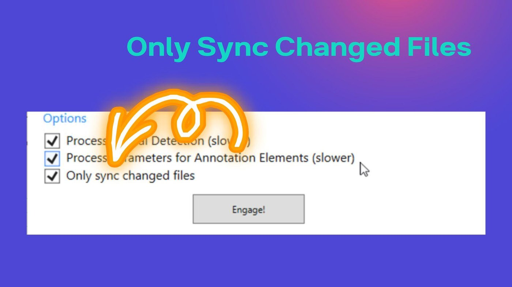
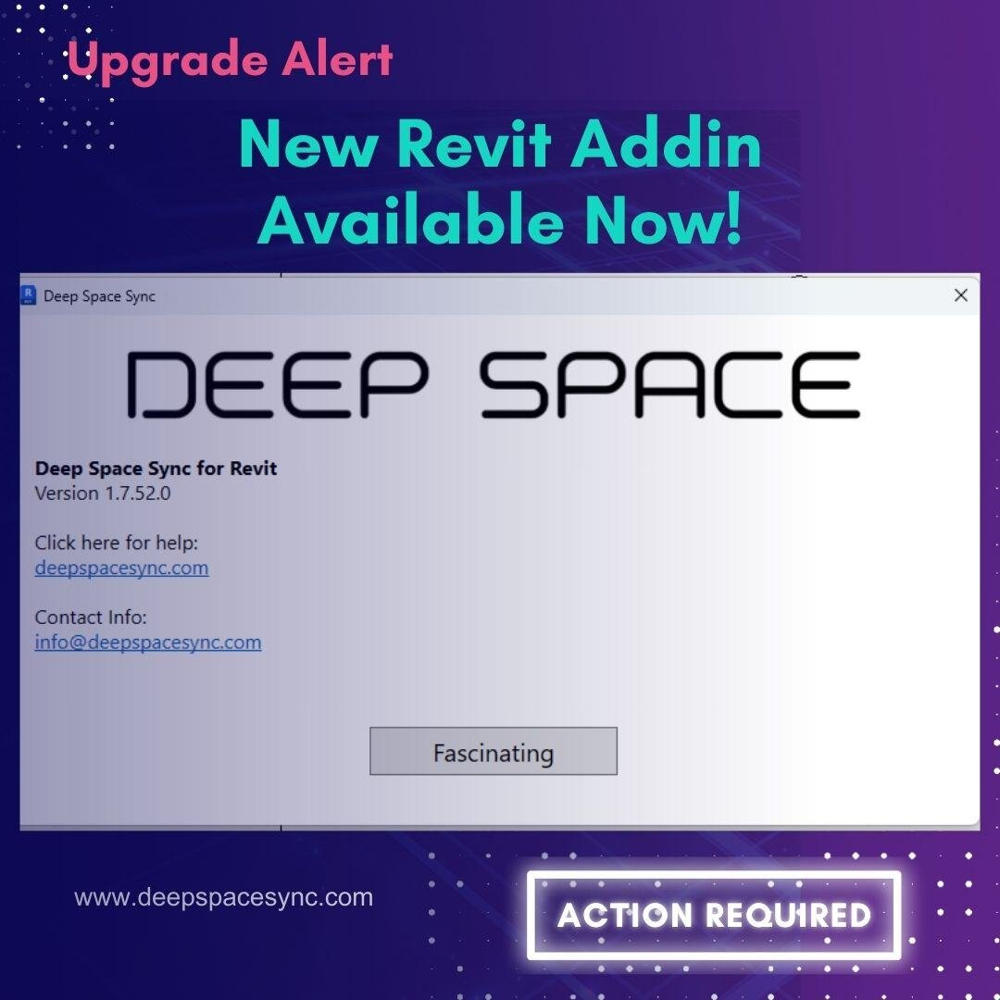
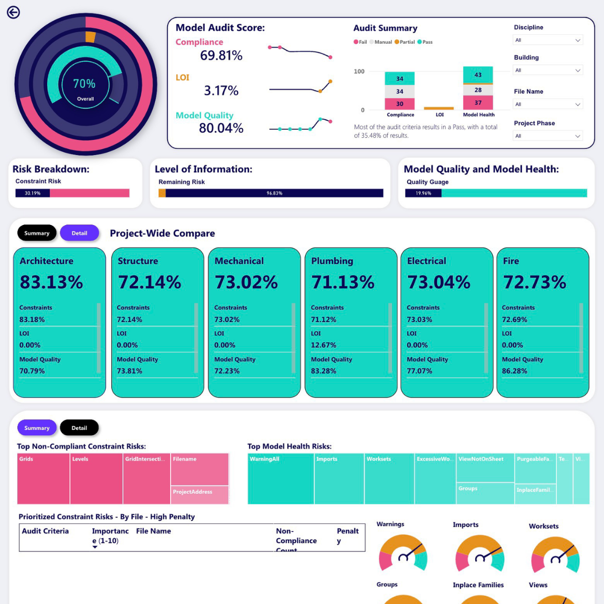
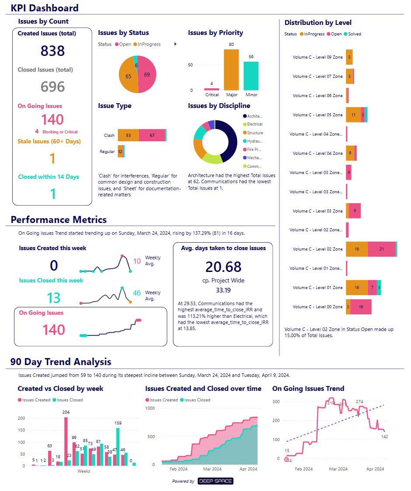
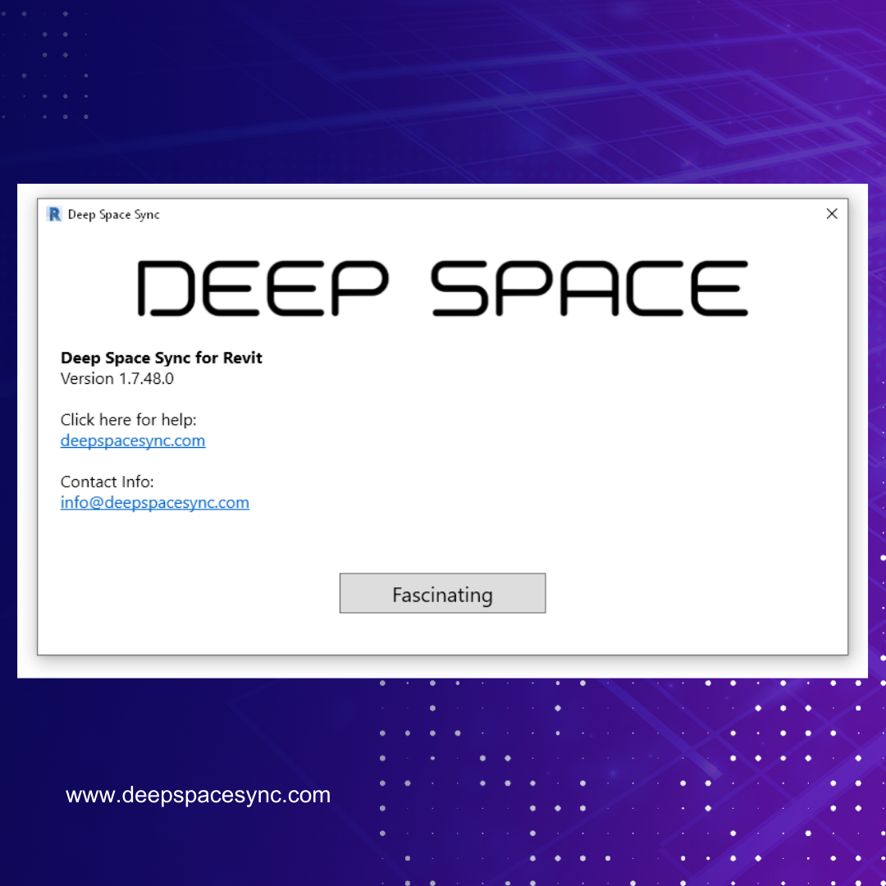
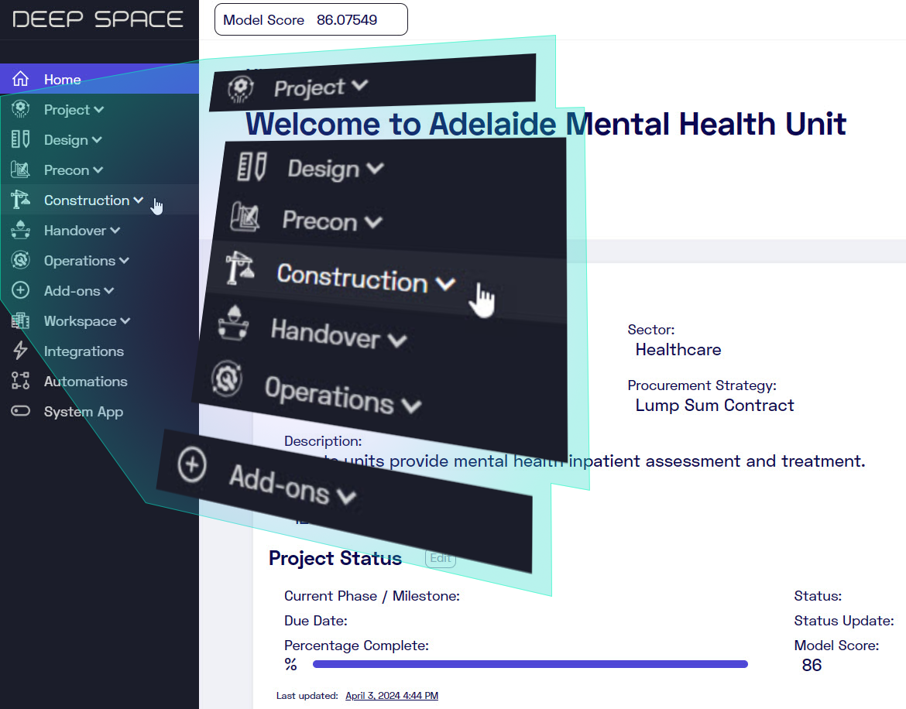
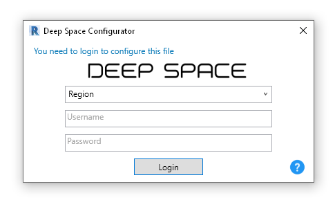

# Changelog 2024

20 updates released in 2024, newest first. See the [changelog overview](index.md) for all years and the category legend.

## Email Correspondence Logging & Mail App Beta Release { #cl-39755 }

DS Platform 12 Dec 2024 #39755

Deep Space now has the ability to log all communications on a project.

#### Log All Emails 📧
* You can send, cc, or forward emails to a project-specific email address to automatically log and catalog communications in Deep Space.

#### Save All Attachments 📎
* Deep Space can securely save all attachments within an email to your project's dedicated Deep Space Document Storage to help organise scattered files.

#### Mail App 📬
* Use the beta version of the Mail App to search across all correspondences and quickly find previous emails with a master search.
* Improve accountability for the whole project team with more visibility into communications.

### Why Did We Build This?
* Reduce project risks by keeping critical emails and documents logged and searchable
* Provide base framework that will allow correspondence to be used as a workflow trigger and as a data point for Deep Space AI features including DS Actions and Risk Detection.
* Introduce support for correspondence record-keeping legal requirements

---

## Integrations Menu + ACC & BIM360 Issues Integration Released { #cl-39669 }

DS Platform 6 Dec 2024 #39669

We’re excited to introduce the **Integrations** menu, designed to make configuring third-party integrations with Deep Space a breeze!

#### Connect Your Data Seamlessly 🔗
* Effortlessly link your data sources to Deep Space with our intuitive new menu.

#### Sync ACC or BIM360 Issues 🚀
* You can now sync Autodesk Construction Cloud (ACC) or BIM360 Issues with Deep Space. Check out our [step-by-step guide](https://support.deepspacesync.com/en/articles/autodesk-integration) to set it up for your projects.

#### More integrations coming soon! ⚡
* This is only the beginning! Keep an eye out as we continue to release more integrations

### Why Did We Build This?
* Faster & simpler for users to set up new integrations and start syncing data
* Support faster development to connect to more data sources in the future
* A central place to manage integrations in Deep Space

---

## Unified Project & User Management System Released { #cl-39401 }

DS Platform 28 Nov 2024 #39401

The new Unified Project & User Management System, consolidates all user management & permissions into a single place in Deep Space.

#### Single Login & Permission Handling: 🔒
* Deep Space logins between the Revit Addin and DS Platform have now been unified with a shared permission system. Check out the [Deep Space User Permissions](https://support.deepspacesync.com/en/articles/deep-space-permissions) knowledge base article.
* Removes the need to log in twice to use DS Actions, leading to a smoother user experience.

	*For those with access to both systems, please use your previous Revit password to login to Deep Space everywhere*

#### New Admin Console: ⚙️
The new admin console provides an intuitive interface to manage users and other configuration across your portfolio of Deep Space projects.

* **Workspace Manager**: Manage users, permissions, projects, and companies for workspace managers
* **Project Manager**: Manage users, permissions, and teams for project managers 

#### Project Switcher: 🔁
You can now switch between projects in Deep Space without needing to log out!

#### Seat-Based Licensing: 👤
* We've completed the back-end work to support our new seat-based licensing model, allowing greater flexibility about how you manage and access projects in Deep Space.

### Why Did We Build This?
* Simplify user experience
* Smoother onboarding
* Easier management of Teams, which enables other Deep Space tools like Actions to work more effectively
* Faster project creation meaning you can use Deep Space on more projects and get more value
* Manage the new seat based licensing more easily

---

## DS Variations v2 Released! { #cl-39240 }

DS Pro for Design 22 Nov 2024 #39240

Variations v2 now supports Project Milestones!

* create Project Milestones
* view object counts
* quickly pick which milestones you want to compare
* view model quantities
* quantities are linked with spatial information included Building, Level and Room
* see summarised quantities by Category, Family and Type
* pick which Parameter you want to display
* export the summarised data

What's changed here? The previous version of Variations only supported 2 moments in time and required a dataset refresh, but this version allows you to dynamically pick which Milestones to compare. Much faster and more powerful for the end user, this gives key insight on changes in the project over time, which can affect Claims and Variations.

---

## DS Programme App Updated! { #cl-39073 }

DS Pro for Design 18 Nov 2024 #39073

* allow to browse Project Milestones in Programme App

!!! warning "Missing image · MISSING-IMG-39073-1"
    `milestones.png` has not been recovered yet. Original location: `https://storage.sleekplan.com/products/287727888/changelog/39073/inline-b6c6d25c050250de262f1a1510ca288a.jpg`

---

## DS Track Updated! { #cl-39051 }

DS Pro for Construction 15 Nov 2024 #39051

* DS Workflows modified to use IfcGuid parameter value
* Track dashboard improved visuals
* Kg units used for steel mass

---

## DS BIM - Multiple Apps Updated! { #cl-38978 }

DS Pro for Design inferred 13 Nov 2024 #38978

* **Super Schedule** - new simplified filtering that will be consistent across DS BIM apps
* **Data** App - new filters for Parameters, enhanced File Information visual
* **Files** App - more visual feedback on File Size, enhanced ability to review Links, improved consistent navigation
* **Sheets** - Sheet Browser page added with simplified Sheet and View list
* **RDS** - new overview Room Browser that is easier to navigate in our Room Data Sheet app

---

## DS Sync for Revit - Version 1.7.54 { #cl-38949 }

DS Sync for Revit inferred 11 Nov 2024 #38949

* Revit 2025 support added
* Scheduler improvements - on demand job now shown in completion list
* Fascia and Gutter Parameter collection
* View Template flag added to Revit View metadata

Download latest version [at this link](https://cdn.deepspacesync.com/DeepSpaceSyncInstaller.msi)

---

## Integrated Feedback Widget Released { #cl-38918 }

DS Platform inferred 10 Nov 2024 #38918

* Users can now raise feedback from any app in Deep Space web

Use the "Feedback" button on the right of the active window, then pick the Category and describe your feature request or issue. Thanks for helping us make Deep Space even better!

---

## DS Workflows Released! { #cl-38915 }

DS Platform inferred 4 Nov 2024 #38915

* asynchronous Job running engine
* integrated with Deep Space API
* initially utilised in Deep Space Track (DS Construction) workflows

---

## DS Site - 3 New Templates Released! { #cl-38917 }

DS Site inferred 3 Nov 2024 #38917

DS Site provides the following 3 templates for fast mobilisation:

* Domestic Builder
* Civil
* Roofing

---

## DS Site - Fast User and Channel Setup Feature (Public Preview) { #cl-38916 }

DS Site inferred 31 Oct 2024 #38916

* Previously under the codename "Project Genesis", this allows DS Site users to set up their own channel based on a template
* Submitted form data from site is captured into DS Platform for analysis

---

## Programme Data Integration { #cl-38914 }

DS Platform inferred 20 Aug 2024 #38914

* Asta, P6 and other 4d programme import via Deep Space API
* Ability to view Programme data in new Programme App

---

## Deep Space API - v1.0 Released! { #cl-38913 }

DS Platform inferred 6 Aug 2024 #38913

* Authenticated API
* Public endpoints available
* Allow to 'upload any data'

See API Documentation at 

---

## DS Sync for Revit - Version 1.7.52 { #cl-38889 }

DS Sync for Revit inferred 9 Jul 2024 #38889

### What’s New:
* Selective Syncing: A new checkbox option to 'only sync changed files,' significantly improving workflows and sync times for large federated models.
* Actions: Automated Actions following sync.
* Bug Fixes: Various improvements for smoother performance.

??? note "From the announcement email (9 Jul 2024)"
    What was new in Deep Space Sync for Revit 1.7.52:

    * **Selective syncing:** a new *only sync changed files* checkbox, significantly improving workflows and sync times for large federated models.
    * **Actions:** automated Actions following a sync.
    * **Bug fixes:** various improvements for smoother performance.

    <figure markdown="span">
      { loading=lazy }
      <figcaption>The new 'only sync changed files' option</figcaption>
    </figure>

    <figure markdown="span">
      { loading=lazy }
      <figcaption>Deep Space Sync for Revit 1.7.52 announcement tile</figcaption>
    </figure>

    
Source: HubSpot email &quot;Deep Space: New Revit Addin Available Now!&quot;, support@deepspacesync.com, 2024-07-09

---

## Deep Space Actions Released! { #cl-38892 }

DS Platform inferred 31 May 2024 #38892

### ⚡ Deep Space Actions
* Automated Action creation, tracking and close-out: Save time checking Deep Space and instead get insights directly emailed to you in addition to reminders and close notifications.
* Weekly update emails by discipline: Custom notifications sent to all team members of current, closed, and updated actions each week.
* Support for project or workspace-level customisation: Toggle which actions your project or suite of projects need.
* Actions Library & Actions Dashboard - new apps: Two new apps to support Deep Space Actions to view historical insights of all actions and notifications and see which actions are enabled for your project.
* Audit Trail for Actions and Notifications: track all actions and progress states including when each notification was sent and to which recipients

Check out the new [Deep Space Actions Knowledge Base](https://support.deepspacesync.com/en/articles/deep-space-actions) for more details on what actions are currently released.

Also see [this post](https://www.linkedin.com/posts/charlottetowell_deepspace-digitalconstruction-automation-activity-7205831365643169793-Mput?utm_source=share&utm_medium=member_desktop)

---

## Space News, Episode 8 — development updates { #cl-a-20240418 }

DS Platform inferred 18 Apr 2024 announcement email

Episode 8 of the Space News newsletter rounded up the development work shipped in early 2024.

### Huge update with Hybrid V2 Core Thread Technology

A major leap forward with an upgrade to Deep Space's Core Thread Technology — a new **Hybrid V2** model. The enhancement is not just about bigger data storage: it is about smarter, faster access to the data you need when you need it. V2 means quicker querying, increased integration capabilities, and the ability to scale massively to meet project demands.

!!! warning "Missing image · MISSING-IMG-a-20240418-0"
    `Core Thread Technology Hybrid V2` has not been recovered yet. Original location: ``

.jpg)

### Model Audit App

The Model Audit App received a substantial upgrade to provide more precise and actionable insights:

* **New Overview page:** high-level summaries and detailed project information at a glance.
* **Comprehensive reports:** enhanced detailed reports at the file and discipline level, giving a macro view of project progress and detailed insights into specific areas.
* **Improved algorithm accuracy:** adjustments and recalibrations to better handle edge cases and provide fairer, more accurate model scores.

<figure markdown="span">
  { loading=lazy }
  <figcaption>The new Model Audit overview: overall score, audit summary, risk breakdown and project-wide compare by discipline</figcaption>
</figure>

### Assets App

Asset management capabilities received a substantial boost: 20 automated procedures refined and 14 Asset Detection algorithms integrated, all tailored to streamline the asset management process across projects.

### Coordination App

The Coordination App gained new reporting features that provide clearer insights and accountability across project teams.

<figure markdown="span">
  { loading=lazy }
  <figcaption>Coordination App KPI dashboard: issues by status, priority, type and discipline, with 90-day trend analysis</figcaption>
</figure>

### Deep Space UI

A redesigned Menu UI that enhances navigation for Deep Space projects:

1. **Streamlined project stages:** apps organised by Design, Precon, Construction, Handover and Operations.
2. **Project-focused organisation:** Teams, Data and Files live in the **Project** folder.
3. **Add-ons:** tools and third-party apps that integrate with Deep Space for added clarity and transparency.

### Expansion: a new data centre in Saudi Arabia

Deep Space established a new data centre in Dammam, Saudi Arabia, providing faster, more secure and locally compliant data management for users in the region. The development team also launched the **region-selectable Revit add-in**, enabling users throughout Saudi Arabia to use Deep Space.

<figure markdown="span">
  { loading=lazy }
  <figcaption>Deep Space in KSA</figcaption>
</figure>

### New Revit add-in available

A reminder of the 1.7.48 add-in release: petabyte-scale handling, multi-region support, advanced analytics, larger upload chunks (1 million rows), quicker dashboard refreshes and cost-effective scaling. See [DS Sync for Revit — Version 1.7.48](2024.md#cl-38888).

<figure markdown="span">
  { loading=lazy }
  <figcaption>New Revit add-in announcement tile</figcaption>
</figure>

---

## Navigating Your Projects Just Got Easier — redesigned Menu UI { #cl-a-20240408 }

DS Platform inferred 8 Apr 2024 announcement email

The latest iteration of the Deep Space experience: a redesigned, intuitive **Menu UI** built around easier navigation.

### Here's what's new

* **Streamlined project stages:** Deep Space apps are now organised to mirror the project lifecycle — Design, Precon, Construction, Handover, Operations.
* **Project-focused organisation:** essential project views like Teams, Data and Files are tucked into the **Project** folder for easy access.
* **Add-ons:** discover additional tools and third-party apps that integrate with Deep Space, designed to accelerate projects and provide clarity and transparency where it's needed.

<figure markdown="span">
  { loading=lazy }
  <figcaption>The redesigned Deep Space menu, organised by project stage</figcaption>
</figure>

---

## DS Sync for Revit - Version 1.7.48 { #cl-38888 }

DS Sync for Revit inferred 20 Feb 2024 #38888

### New Components
* Region selector - choose AUS for current Australian server, KSA for Saudi Arabia server

??? note "From the announcement email (20 Feb 2024)"
    **Action needed at the time:** to use the new multi-region platform, users had to install Revit Addin version 1.7.48 or newer before 11 pm on 23 February 2024. The update was critical for continuing to sync without interruption.

    **New region selector:** the add-in gained a region selector, so users could choose **AUS** for the Australian server and control where their data lives.

    <figure markdown="span">
      { loading=lazy }
      <figcaption>The new region selector in the Revit add-in login</figcaption>
    </figure>

    
Source: HubSpot email &quot;Upgrade Alert: New Revit Addin Available Now! - Action Required&quot;, support@deepspacesync.com, 2024-02-20

---

## DS Platform - Accelerated Infrastructure and Multi-region Support { #cl-38887 }

DS Platform inferred 20 Feb 2024 #38887

### Feature Enhancements
* Petabyte scale 
* Multi-region support
* More Advanced Analytics Capabilities
* Faster uploading with larger chunk sizes (1 million rows per chunk instead of 1000)
* Faster dashboard refresh
* Ability to scale your data and store historical data in a cost-effective way

??? note "From the announcement email (20 Feb 2024)"
    Deep Space's platform took a significant leap forward with this release. Here's what was new:

    * **Petabyte-scale handling:** manage massive datasets with ease.
    * **Multi-region support:** access Deep Space across different regions.
    * **Advanced analytics:** dive deeper into your data with enhanced analytics tools.
    * **Efficiency upgrades:** faster uploads thanks to larger chunk sizes — now 1 million rows per chunk.
    * **Quicker dashboards:** faster dashboard refreshes for quick insights.
    * **Cost-effective scaling:** store historical data more affordably and efficiently.

    <figure markdown="span">
      { loading=lazy }
      <figcaption>Deep Space Evolves — new Revit add-in announcement tile</figcaption>
    </figure>

    
Source: HubSpot email &quot;Upgrade Alert: New Revit Addin Available Now! - Action Required&quot;, support@deepspacesync.com, 2024-02-20

---
