# Changelog 2025

55 updates released in 2025, newest first. See the [changelog overview](index.md) for all years and the category legend.

## In-App Notifications Now in Deep Space { #cl-46985 }

DS Platform 23 Jul 2025 #46985 <button class="cl-copy" type="button" data-anchor="cl-46985" title="Copy a direct link to this entry">Copy link</button>

We've just released **Deep Space**'s brand new notification system! This includes a whole new notification experience in Deep Space + new features like automated insurance expiry notifications & action assignment emails!

#### 🔔 Updates in-app
* Log in to your projects & see the latest notifications at a glance
* Mark notifications as read to stay focused on whats new

<figure markdown="span">
  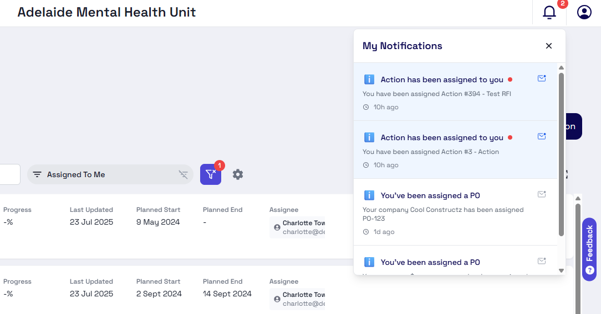{ loading=lazy }
  <figcaption>InAppNotifications.png</figcaption>
</figure>

#### 📧 Integrated with Emails
* Notifications get sent directly to your inbox so you never miss an update
* Preview the email content from the in-app panel

<figure markdown="span">
  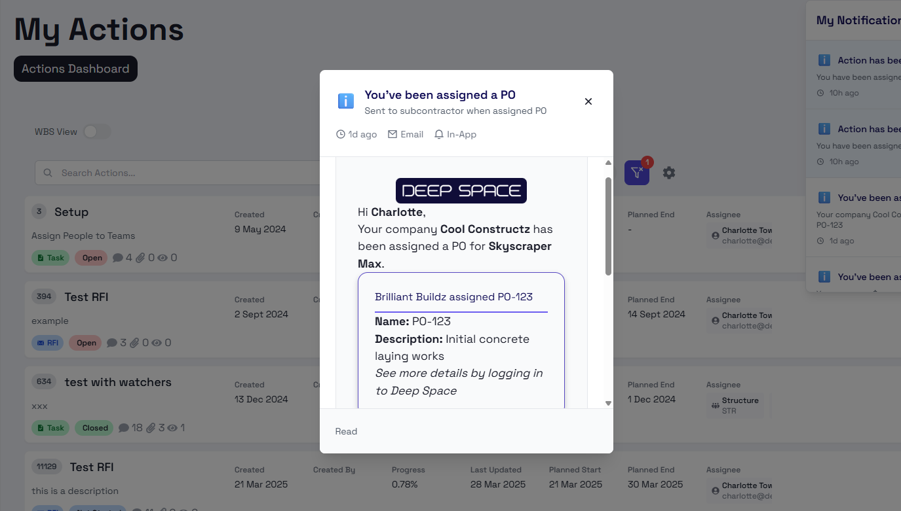{ loading=lazy }
  <figcaption>NotificationEmailPreview.png</figcaption>
</figure>

#### ⏰ Automated Insurance Expiry Reminders
* When uploading insurance documents via our **Vendor Management** tool, you now receive reminder emails 1 month, 1 week, and 1 day before your specified expiry date, helping you stay compliant

<figure markdown="span">
  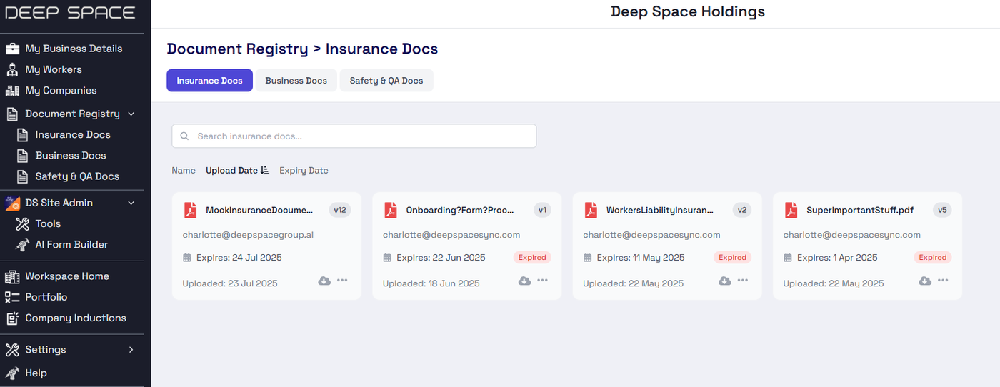{ loading=lazy }
  <figcaption>InsuranceExpiry.png</figcaption>
</figure>

**Why Did We Build This?**

* Create a unified experience for users to stay up to date with their projects
* Build the back-end functionality to support advanced notification automations
* Release automated insurance expiry notifications for vendor management
* Enhance Deep Space Actions with automation assignment reminders

---

## 🎯 Align Line Items Directly with Budget Items { #cl-46923 }

DS Platform 20 Jul 2025 #46923 <button class="cl-copy" type="button" data-anchor="cl-46923" title="Copy a direct link to this entry">Copy link</button>

### 🔗 Link Line Items to Budget Items for Greater Clarity

Deep Space now lets you connect your Cost Orders and Budget Items together, giving contractors more control and transparency in cost tracking.

!!! warning "Missing image · MISSING-IMG-46923-1"
    `8f4a32b48aeb09e5f3c1af4db76b872d.png` has not been recovered yet. Original location: `https://storage.sleekplan.com/products/287727888/changelog/46923/inline-d7c7a820829eb683ea99e3bd4a179155.jpg`

#### 🧷 Connect Line Items to Budget Items  
You can now assign each Line Item to a specific Budget Item in the Cost Order interface.

- Choose the most appropriate Budget Item for each Line Item  
- View detailed budget info during selection, including amounts and descriptions  
- Link or update anytime based on scope and progress  

<figure markdown="span">
  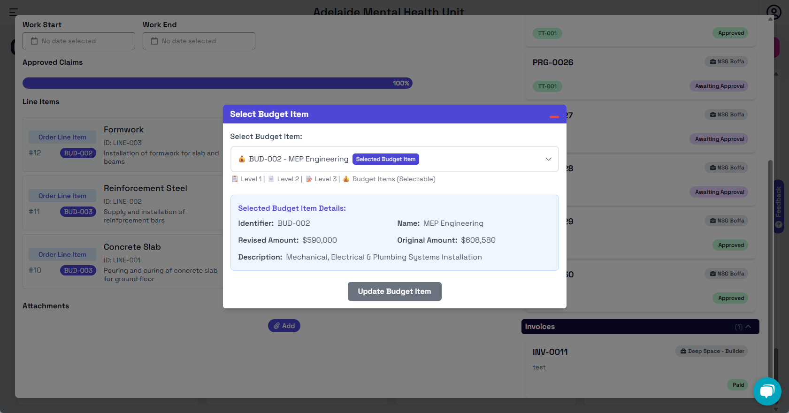{ loading=lazy }
  <figcaption>1ddb68ab661aa6751fe84b3fe60521e7.png</figcaption>
</figure>

#### 🔎 Check Link Status in Real Time  
Each Line Item clearly displays whether it is linked to a budget.

- Unlinked items are flagged, helping avoid missing costs  
- Linked items display the Budget Identifier for easy reference  
- View Cost Order overview to quickly see if all items are budgeted  

<figure markdown="span">
  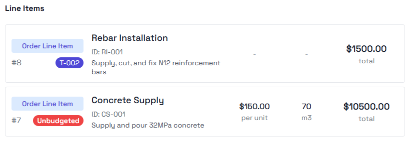{ loading=lazy }
  <figcaption>c9a0018b4704269040c85853b2530d97.png</figcaption>
</figure>

<figure markdown="span">
  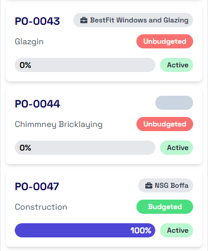{ loading=lazy }
  <figcaption>45fb933e3b048599f61b709c0d0c4bd6.png</figcaption>
</figure>

#### 📊 View Committed Cost in Budget App  
You can now track total committed cost per Budget Item — right inside the Budget view.

- Instantly see how much has been committed from linked Cost Orders  
- Get a live, consolidated view of your project’s spending  
- Supports better forecasting and financial control  

!!! warning "Missing image · MISSING-IMG-46923-5"
    `aaa897f087f58097d8d1b53dab28f8ec.png` has not been recovered yet. Original location: `https://storage.sleekplan.com/products/287727888/changelog/46923/inline-891e8b460c2ccdfcd564cabc8bc42d89.jpg`

### 📌 Why Did We Build This?

- Help contractors clearly see which cost items are covered by the budget  
- Reduce the risk of missing or unapproved costs  
- Make it easier to link cost and budget while creating or reviewing orders  
- Show committed costs directly within the Budget App  
- Improve project visibility for finance and site teams  
- Support accurate claims and avoid overspending  
- Make audit and reporting more reliable by connecting each cost to its scope

---

## Break Down Your Costs with New Line Items📦 { #cl-46757 }

DS Platform 14 Jul 2025 #46757 <button class="cl-copy" type="button" data-anchor="cl-46757" title="Copy a direct link to this entry">Copy link</button>

Deep Space's Cost Management module now supports detailed **Line Item** tracking, giving you better control and clarity when managing cost orders, claims, and invoices.

<figure markdown="span">
  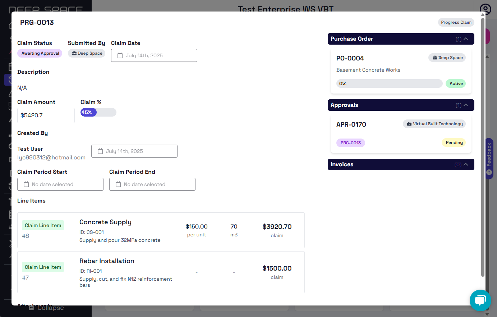{ loading=lazy }
  <figcaption>00e5b054fd57454ec18fa6e0e8ecf6c5.png</figcaption>
</figure>

#### ➕ Add Line Items in Cost Orders
You can now add Line Items directly when creating a new Cost Order.

- Choose between **Unit Price** or **Total Amount** input, depending on how you track costs  
- Fill in key details like identifier, item name, description, unit, quantity, and price  
- The system auto-calculates the line total, helping avoid manual mistakes and speeding up the process  

<figure markdown="span">
  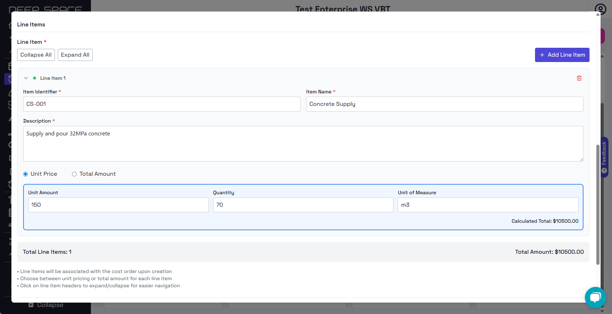{ loading=lazy }
  <figcaption>a7ec6bb94d09dccaf263a89438883f0f.png</figcaption>
</figure>

!!! warning "Missing image · MISSING-IMG-46757-3"
    `9a025427c218b697767e5c3b962b1f35.png` has not been recovered yet. Original location: `https://storage.sleekplan.com/products/287727888/changelog/46757/inline-2f3c33f621253b7bc18700b4bd11a3f0.jpg`

#### ✅ Double Check Key Info Before You Proceed
To help you avoid issues down the line, each Line Item requires key fields.

- The interface guides you to input all necessary fields before submission  
- Ensures accuracy and completeness, especially helpful in large or complex cost orders  
- Reduces the risk of missing costs or miscommunication during approvals  

!!! warning "Missing image · MISSING-IMG-46757-4"
    `a7e30606edd1127e4acc932645bdb1b2.png` has not been recovered yet. Original location: `https://storage.sleekplan.com/products/287727888/changelog/46757/inline-864f13450f1dd7b2ae2e4d3ff0f979e2.jpg`

#### 💰 Make Claims with Precision
When creating a Claim, you can now:

- Select specific Line Items to include in the claim, instead of applying a bulk percentage  
- Use sliders or number inputs to set the claimed amount per item  
- See the total claim value update in real time, ensuring your numbers are accurate before submission  

<figure markdown="span">
  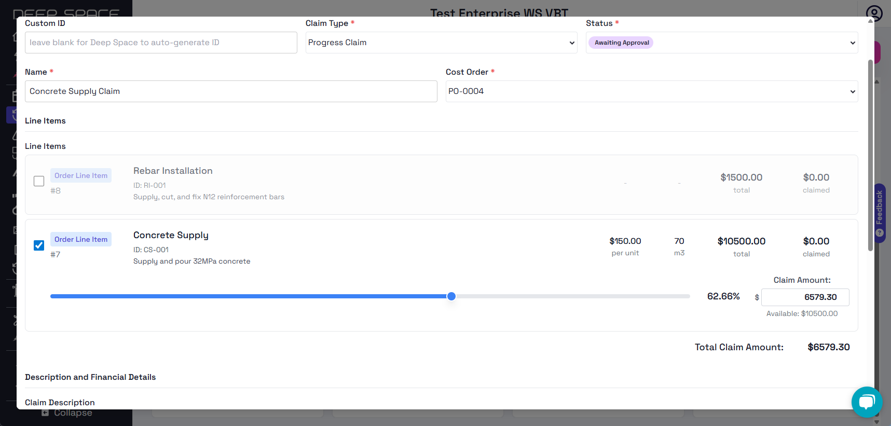{ loading=lazy }
  <figcaption>1a525e1e2cf64f82c1c1d97fe0d9c365.png</figcaption>
</figure>

#### 📊 Track Order Progress More Clearly
Cost Order progress now updates dynamically based on claimed amounts.

- As Claims are submitted and approved, progress bars reflect actual completion  
- Fully claimed orders will be automatically marked in the dropdown and detail views  
- Makes it easier for teams to see which orders are done and which are still in progress  

!!! warning "Missing image · MISSING-IMG-46757-6"
    `a4238ea1dafaa74597832e55000f44fd.png` has not been recovered yet. Original location: `https://storage.sleekplan.com/products/287727888/changelog/46757/inline-60619faab74915a1bdcabe259dba6e1e.jpg`

!!! warning "Missing image · MISSING-IMG-46757-7"
    `d0ef599bf081bb141d79d24776fb6c84.png` has not been recovered yet. Original location: `https://storage.sleekplan.com/products/287727888/changelog/46757/inline-1902d1ae4b8ace1084b387beedf1cdb1.jpg`

#### 🔍 View Line Items Anytime
You can now view the full breakdown of Line Items in:

- **Purchase Order Detail Page** – See what was originally committed  
- **Claim Detail Page** – Track how much has been claimed per item  
- **Invoice Detail Page** – Verify billed amounts against what's been claimed  

<figure markdown="span">
  { loading=lazy }
  <figcaption>00e5b054fd57454ec18fa6e0e8ecf6c5.png</figcaption>
</figure>

📌 *Why Did We Build This?*

- To help users break down costs more clearly and avoid confusion in complex orders  
- To make it easier to track, adjust, and claim exactly what’s been done — no more guesswork  
- To reduce mistakes by guiding users to enter complete and accurate cost details  
- To give teams a clearer picture of project progress through real-time claim and order updates

---

## Prefill Induction Forms With Company Metadata { #cl-46719 }

DS Pro for Construction 11 Jul 2025 #46719 <button class="cl-copy" type="button" data-anchor="cl-46719" title="Copy a direct link to this entry">Copy link</button>

Following our recent release of [Upgraded Vendor Management - Fully Customisable Metadata](2025.md#cl-46649), you can now generate **pre-filled** form submissions to send to your subcontractors. 

#### 👷 Pre-filled Induction Directly via Email
* Configure once, and then watch the automation as your induction emails are now pre-populated
* Specify metadata like **trades** or **business unit** for each subcontractor
* Send out pre-filled form links with your defined data to ensure compliance

<figure markdown="span">
  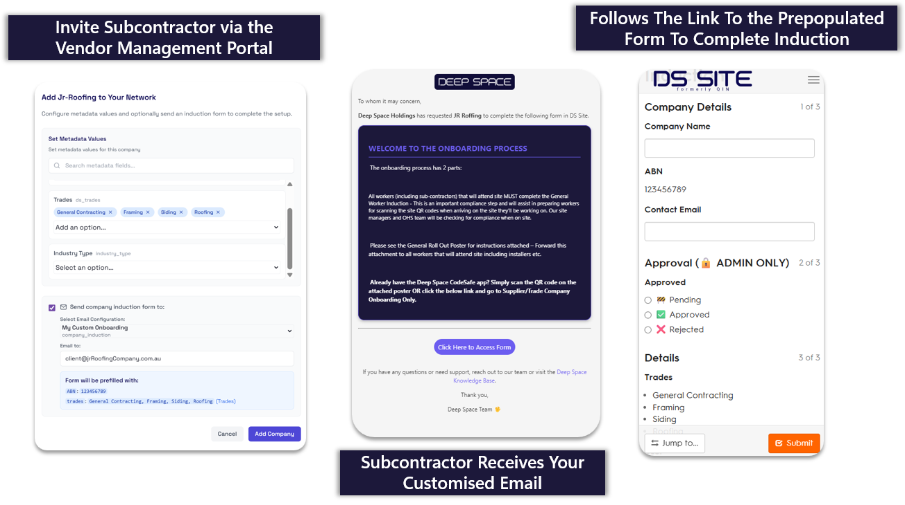{ loading=lazy }
  <figcaption>FormPrefillWorkflow.png</figcaption>
</figure>

#### 🔨 Fully Configurable For Each Induction Workflow
* All parts of the system can be customised to suit your specific needs
* Multiple form fields supported per form
* Easily select which form fields you want pre-populated with which custom metadata

<figure markdown="span">
  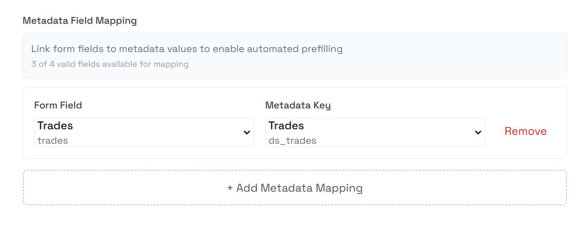{ loading=lazy }
  <figcaption>MetadataFieldMapping.png</figcaption>
</figure>

**Why Did We Build This?**

* Provide more granular management capabilities for your subcontractor inductions
* Make it easier for subcontractors to successfully induct themselves
* Result in cleaner data with stricter validation, eliminating human error

---

## Upload Project Hero Image in Project Manager { #cl-46650 }

DS Platform 9 Jul 2025 #46650 <button class="cl-copy" type="button" data-anchor="cl-46650" title="Copy a direct link to this entry">Copy link</button>

#### ✅ What’s New  
Project Managers can now **upload or update a project’s hero image** directly from the Project Details page.

!!! warning "Missing image · MISSING-IMG-46650-1"
    `94439459817f39daecd475ffeb7ebc07.png` has not been recovered yet. Original location: `https://storage.sleekplan.com/products/287727888/changelog/46650/inline-991f60f7688c0be054f85f923ea3f7a4.jpg`

#### ✨ Key Benefits  
- Visually differentiate projects at a glance  
- Keep your project presentation professional and up-to-date  
- Drag-and-drop or click-to-upload with preview  
- Supports common formats: `JPEG`, `PNG`, `GIF`, `WebP`, `BMP`, `TIFF`, `SVG` (Max: 5MB)

!!! warning "Missing image · MISSING-IMG-46650-2"
    `16518d1a8a3d6aaf2d0672258486357e.png` has not been recovered yet. Original location: `https://storage.sleekplan.com/products/287727888/changelog/46650/inline-92c3b15a0b302e35d2327a24081e697c.jpg`

#### 📍 Where to Find It  
Go to:  
`Admin Console` → `Project Details` → scroll to the **Project Image** section.

#### 🚀 Why Did We Build This?  
- To give teams more control over how projects are presented  
- To improve visual clarity when reviewing project data

---

## Upgraded Vendor Management - Fully Customisable Metadata { #cl-46649 }

DS Pro for Construction 9 Jul 2025 #46649 <button class="cl-copy" type="button" data-anchor="cl-46649" title="Copy a direct link to this entry">Copy link</button>

Deep Space's **Vendor Management** tool has been upgraded with a new **customisable metadata** system, enabling you to keep track of important fields against your vendors.

### ⛏️ Customise Metadata Requirements
* Create your own metadata definitions to suit your unique needs
* Import pre-defined Deep Space trades
* Control mandatory fields, or multi-select functionality

<figure markdown="span">
  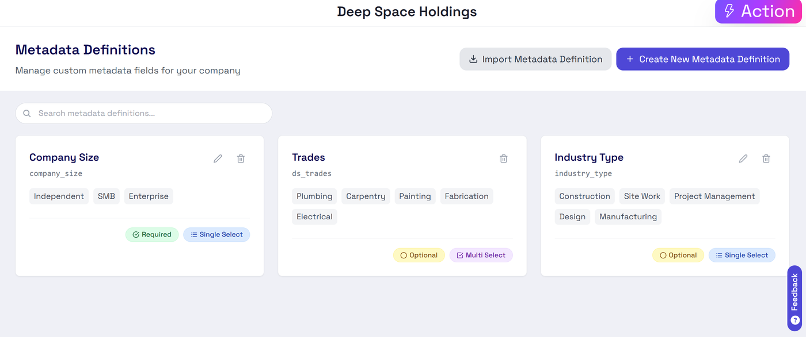{ loading=lazy }
  <figcaption>CustomMetadataDefinitions.png</figcaption>
</figure>

### 👷 Manage For Your Vendors
* Save data against each of your vendors
* Centralised view of all companies & custom fields
* Filtering capability for your custom defined fields & induction statuses

<figure markdown="span">
  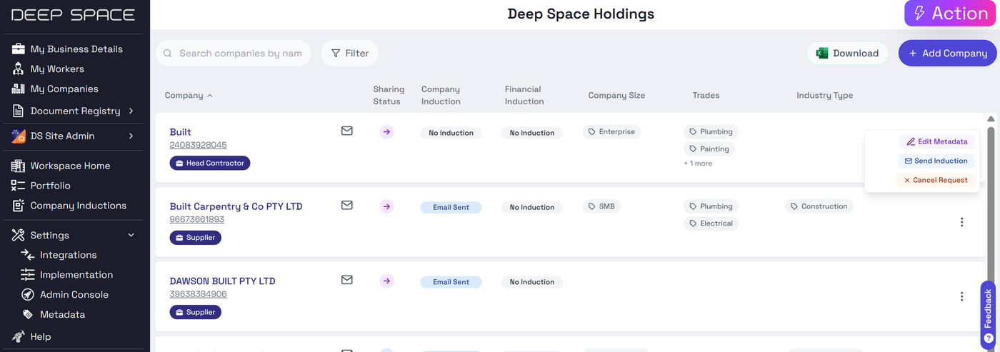{ loading=lazy }
  <figcaption>MetadataFieldsAgainstCompanies.png</figcaption>
</figure>

### ⚡Streamlined Onboarding
* Save custom fields against a vendor when inviting them to your companies
* **🔔 Coming Soon:** Use custom fields to pre-fill induction forms

<figure markdown="span">
  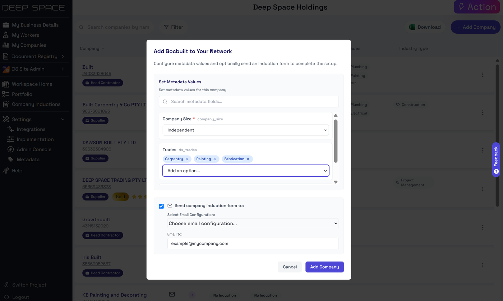{ loading=lazy }
  <figcaption>OnboardingMetadata.png</figcaption>
</figure>

**Why Did We Build This?**

* Support flexible company requirements for vendor compliance & management
* Provide out-of-the box support for managing Trades against a company
* Support future development for automated induction handling based on custom fields

---

## Revit Addin Version 1.8.2 Released { #cl-46610 }

DS Sync for Revit inferred 8 Jul 2025 #46610 <button class="cl-copy" type="button" data-anchor="cl-46610" title="Copy a direct link to this entry">Copy link</button>

* Enhancements to Revit Scheduler

---

## Import Budget From Excel File to Deep Space { #cl-46491 }

DS Platform 3 Jul 2025 #46491 <button class="cl-copy" type="button" data-anchor="cl-46491" title="Copy a direct link to this entry">Copy link</button>

Deep Space's new [**Budget Module**](2025.md#cl-46254) now supports **importing** existing budgets from our template.

#### 💵 Prepopulate New Project Budgets from Excel

<figure markdown="span">
  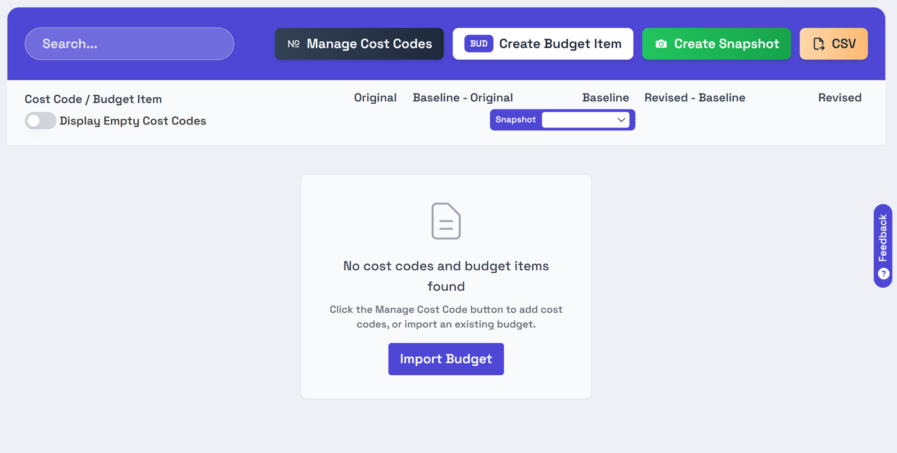{ loading=lazy }
  <figcaption>ImportBudgetText.png</figcaption>
</figure>

#### 📁 Download the Template
* Simply fill in your existing budget line items, and cost codes, then upload to your project

<figure markdown="span">
  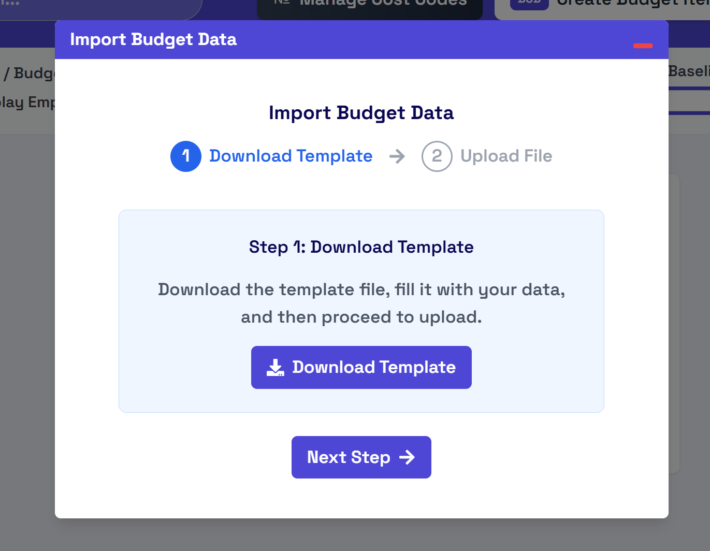{ loading=lazy }
  <figcaption>DownloadTemplate.png</figcaption>
</figure>

**Why Did We Build This?**

* Support easy migration from the estimation phase into Deep Space's budgeting tool
* Provide a simple Excel-based template to facilitate migration

---

## Company Document Registry - Business, Insurance, Safety Docs in One Place! { #cl-46486 }

DS Platform 1 Jul 2025 #46486 <button class="cl-copy" type="button" data-anchor="cl-46486" title="Copy a direct link to this entry">Copy link</button>

Introducing the new **Document Registry** in your Deep Space **Company Management** console!

#### 📄 All your documents in one place
* Upload all your **business**, **insurance** and **safety / quality** documents in a central environmnt
* Capture the full version history of changes
* Support for extended metadata like insurance **expiry dates**

<figure markdown="span">
  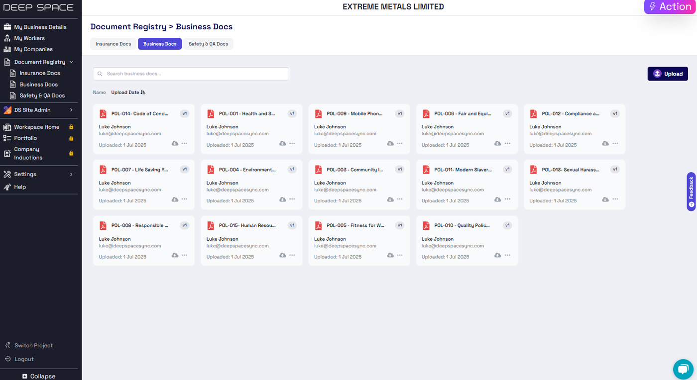{ loading=lazy }
  <figcaption>DocumentRegistry.png</figcaption>
</figure>

**Why Did We Build This?**

* Improve the functionality of workspace-level CDE
* Introduce more document types to help organise your company
* Support future automations of specific document types

---

## Generate Dynamic Links to Deep Space Actions { #cl-46424 }

DS Platform 30 Jun 2025 #46424 <button class="cl-copy" type="button" data-anchor="cl-46424" title="Copy a direct link to this entry">Copy link</button>

You can now generate links directly to **Deep Space Actions**, enhancing collaboration with other users on your project!

#### Simply press the copy button to get a link to the specific action ⚡then share this link with others on the project!

<figure markdown="span">
  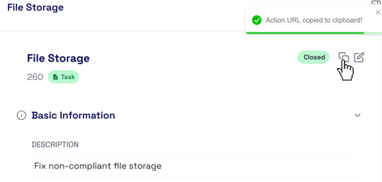{ loading=lazy }
  <figcaption>CopyActionURL.png</figcaption>
</figure>

**Why Did We Build This?**

* Allow easier sharing of Actions outside the platform
* Build functionality to generate hyperlinks to specific areas in the platform

---

## Auto-summarise Emails via AI & Actions { #cl-46333 }

DS Platform 26 Jun 2025 #46333 <button class="cl-copy" type="button" data-anchor="cl-46333" title="Copy a direct link to this entry">Copy link</button>

Following our recent update to **[Create Actions Directly From Your Inbox](2025.md#cl-45550)**, we now support AI summarisation to extract important insights from emails forwarded to your **Deep Space** project!

#### ⚡ Simply Forward an Email Chain to Deep Space!
* AI summarises the entire chain to provide a concise summary
* The Action gets auto-assigned to you for review

<figure markdown="span">
  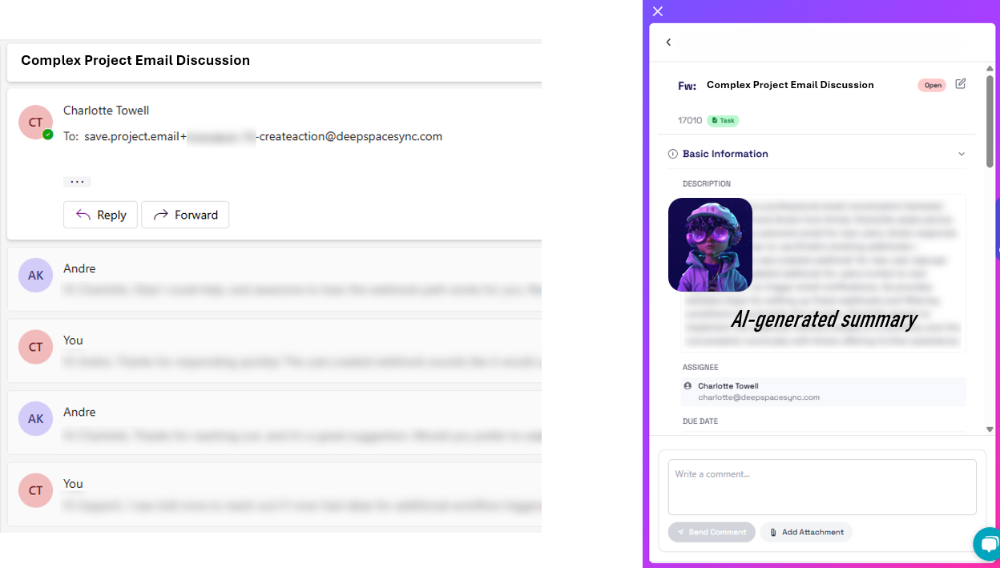{ loading=lazy }
  <figcaption>AIGeneratedEmails.png</figcaption>
</figure>

**Why Did We Build This?**

* Simplify the process of extracting long context information from emails
* Bring AI-enablement to more workflows to save time

---

## Create Action Dependencies to Support Complex Workflows { #cl-46332 }

DS Platform 25 Jun 2025 #46332 <button class="cl-copy" type="button" data-anchor="cl-46332" title="Copy a direct link to this entry">Copy link</button>

In the latest **Deep Space Actions** update, we've released new upgrades including the ability to directly add 2-way dependencies between your Actions!

#### ⌛ Add Dependencies
* Create **Blocked By** or **Blocking** dependencies between Actions
* Enables easy click-through for actions to traverse the dependency path
* Define richer context for tasks and blockers in your project

<figure markdown="span">
  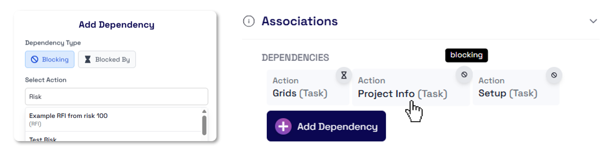{ loading=lazy }
  <figcaption>ActionDependencies.png</figcaption>
</figure>

#### ✏️ Set More Fields on Action Create
* More control when creating an action to set additional fields
* Predefine the timeline (planned, actual & estimated dates)
* Set the WBS + more

<figure markdown="span">
  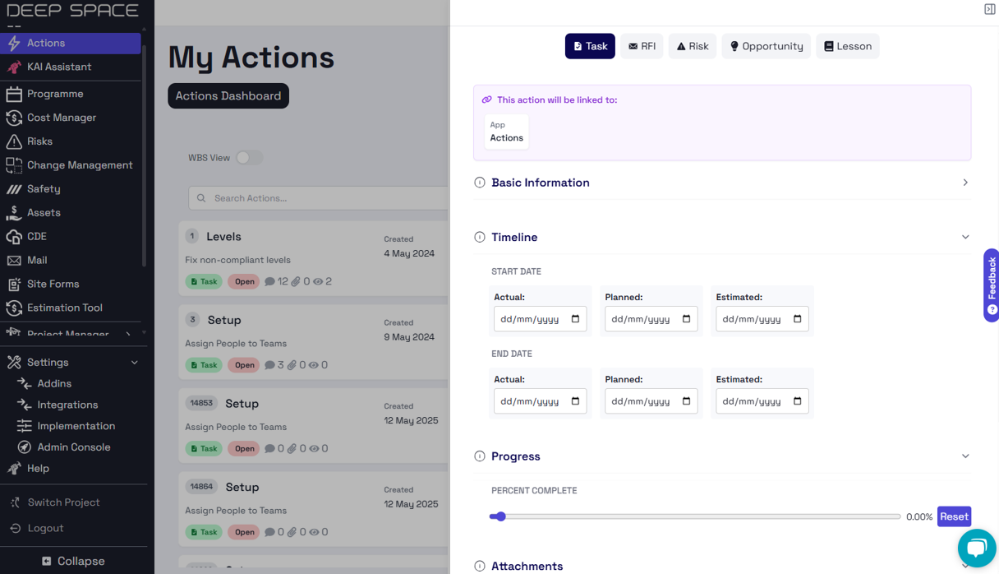{ loading=lazy }
  <figcaption>ActionCreate.png</figcaption>
</figure>

#### 📝 Updated Layout for Better Organisation
* View your Action details, segmented into sections
* Dynmically show or hide sections to create the view you need

<figure markdown="span">
  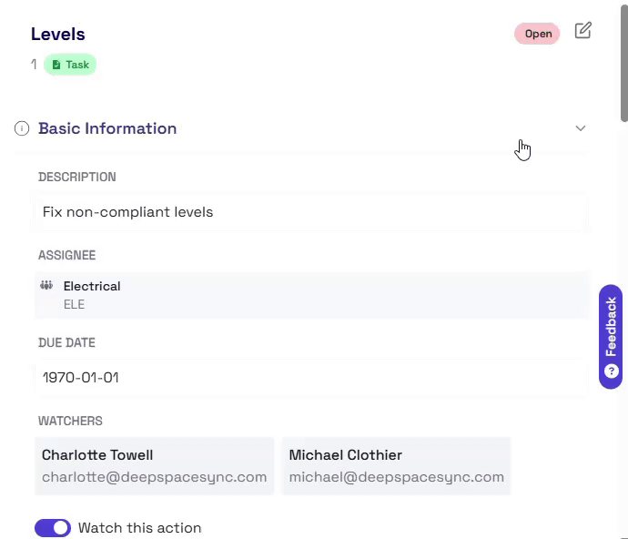{ loading=lazy }
  <figcaption>ShowHideSectionsGIF.gif</figcaption>
</figure>

**Why Did We Build This?**

* Support complex workflows by allowing dependencies to be created between actions
* Streamline the action creation process by including more fields
* Address a number of bug fixes

---

## Introducing Budget Module – Plan, Track, and Report with Confidence { #cl-46254 }

DS Platform 25 Jun 2025 #46254 <button class="cl-copy" type="button" data-anchor="cl-46254" title="Copy a direct link to this entry">Copy link</button>

### 💰 Budget Module – Plan, Track, and Evolve with Confidence

Our new **Budget module** is now live! Built to integrate smoothly with the Cost Code system, this tool gives teams full visibility and control over project budgets — from planning to reporting.

#### 📋 Structured Budget View with Clean Hierarchy  
- View Cost Codes and Budget Items in a clean, collapsible layout  
- Nested structure supports up to **three levels deep**, making it ideal for complex scopes  
- Toggle to hide empty codes for a clearer focus  

!!! warning "Missing image · MISSING-IMG-46254-1"
    `change log (7).png` has not been recovered yet. Original location: `https://storage.sleekplan.com/products/287727888/changelog/46254/inline-aacf187f879484e5afd2e38940f667ea.jpg`

#### ➕ Create Budget Items under Cost Codes  
- Add new Budget Items under any Cost Code node  
- Define unit amount, quantity, unit of measure, or input a total amount directly  
- Automatically calculates total cost and links it to the selected cost structure  

!!! warning "Missing image · MISSING-IMG-46254-2"
    `change log (3).png` has not been recovered yet. Original location: `https://storage.sleekplan.com/products/287727888/changelog/46254/inline-b5505c799cbf1cf41c891b25365c8611.jpg`

#### ✏️ Edit Budget Item Details Anytime  
- Open any item to update name, description, or values (original, baseline, revised)  
- Real-time feedback on changes to see the difference from previous snapshots  
- Simple, focused edit modal for minimal distraction and quick updates  

!!! warning "Missing image · MISSING-IMG-46254-3"
    `change log (8).png` has not been recovered yet. Original location: `https://storage.sleekplan.com/products/287727888/changelog/46254/inline-5b7b9cbfec95af6e4465a4850c694b75.jpg`

#### 🧾 Centralised Cost Code Management  
- Easily create or modify cost codes across all projects  
- Changes reflect directly in the budget list structure  
- Update hierarchy, name, or identifier with a few clicks  

!!! warning "Missing image · MISSING-IMG-46254-4"
    `change log (2).png` has not been recovered yet. Original location: `https://storage.sleekplan.com/products/287727888/changelog/46254/inline-43f14c68509ebbabd0d5e0b6039954d2.jpg`

#### 🕒 Create and Switch Between Snapshots  
- Save budget snapshots by stage (baseline, revised, actuals, etc.)  
- Switch between snapshots in a dropdown to compare different time periods  
- Snapshots lock historical data for consistent reporting  

!!! warning "Missing image · MISSING-IMG-46254-5"
    `change log (9).png` has not been recovered yet. Original location: `https://storage.sleekplan.com/products/287727888/changelog/46254/inline-79cad0a3d93ab7049bafa5d7e6021fe6.jpg`

#### 📤 Export Budget to CSV  
- Download budget data in clean CSV format with one click  
- Option to include or exclude empty cost codes  
- Compatible with Excel for deeper financial reporting or record keeping  

!!! warning "Missing image · MISSING-IMG-46254-6"
    `change log (4).png` has not been recovered yet. Original location: `https://storage.sleekplan.com/products/287727888/changelog/46254/inline-df1cbeacd40b8707ee59911f757b883f.jpg`

!!! warning "Missing image · MISSING-IMG-46254-7"
    `change log (6).png` has not been recovered yet. Original location: `https://storage.sleekplan.com/products/287727888/changelog/46254/inline-34a61af6463042cbdb3648f944a65fdf.jpg`

#### 🚀 Why Did We Build This?  
- To give teams a **practical tool** to track project financials without relying on external spreadsheets  
- To connect **budget items directly to real project scopes and cost codes**  
- To simplify the process of comparing different budget stages — from planning to actuals  
- To provide a **foundation for future features** like forecasting, approvals, and audit reporting

---

## Manage Induction Emails with Deep Space { #cl-46255 }

DS Platform 24 Jun 2025 #46255 <button class="cl-copy" type="button" data-anchor="cl-46255" title="Copy a direct link to this entry">Copy link</button>

The latest update to the Deep Space **Company Management** platform allows you to configure & send your induction or onboarding emails directly from the **My Companies** console.

#### 📧 Email Customisation Options
* Map your existing DS Site induction forms to a new email configuration
* Support for limited customisation & styling options
* Add up to 1 attachment to be sent with your email

<figure markdown="span">
  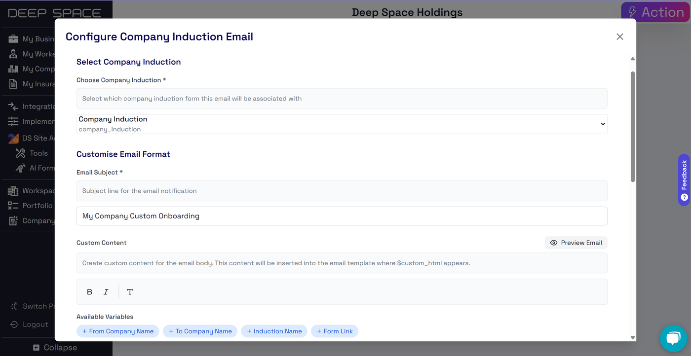{ loading=lazy }
  <figcaption>ConfigureCompanyInductionEmail.png</figcaption>
</figure>

#### 👁️Live Preview
* Maintain full visibility to emails being sent on your behalf by Deep Space by previewing your custom options

<figure markdown="span">
  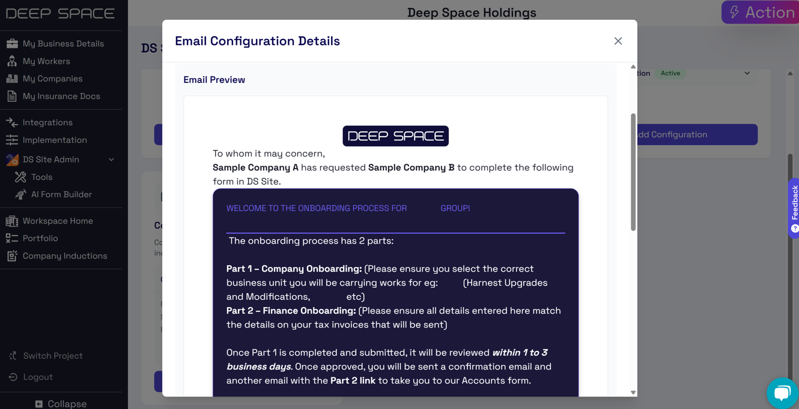{ loading=lazy }
  <figcaption>EmailPreview.png</figcaption>
</figure>

#### ⚡Automatically Send Induction Emails
* Send your configured email template whenever a new company is added to your vendor list
* Maintain a complete end-to-end record of induction completion from "Email Sent" through to "Approved" form submissions

<figure markdown="span">
  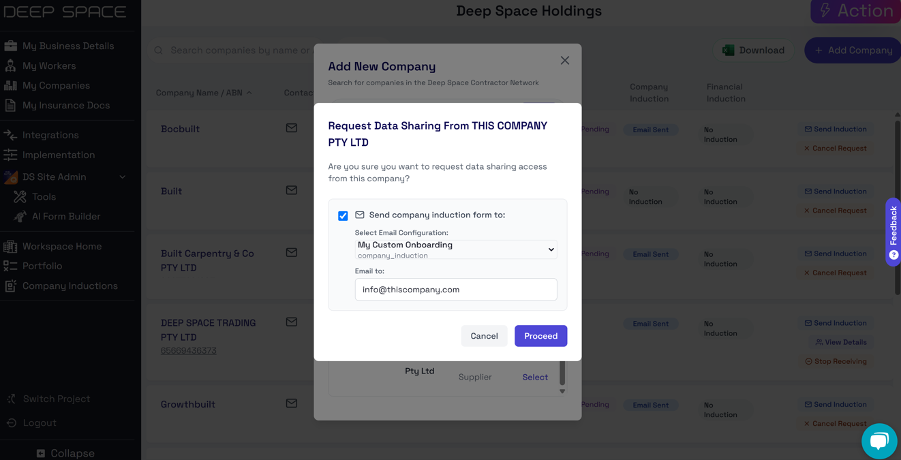{ loading=lazy }
  <figcaption>SendEmailOncompanyAdd.png</figcaption>
</figure>

**Why Did We Build This?**

* Provide end-to-end visibility into induction completion status
* Allow induction management from a single platform, including sending out emails
* Save time by automating re-used email templates

---

## Automatically Create DS Site Forms From PDFs with AI ✨ { #cl-45966 }

DS Site 19 Jun 2025 #45966 <button class="cl-copy" type="button" data-anchor="cl-45966" title="Copy a direct link to this entry">Copy link</button>

**DS Site** is now **AI-enhanced** ✨ with our new automatic form builder, allowing easy migration from legacy form systems into DS Site.

<figure markdown="span">
  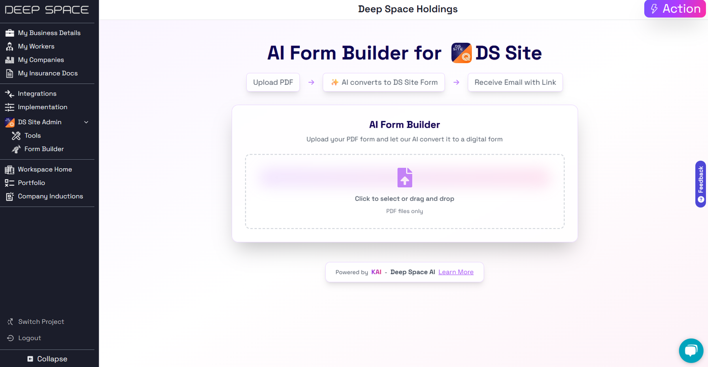{ loading=lazy }
  <figcaption>AIFormBuilderDSSite.png</figcaption>
</figure>

#### 📝PDF Support
* Upload any PDF document for AI to analyse and transform into a DS Site Form

<figure markdown="span">
  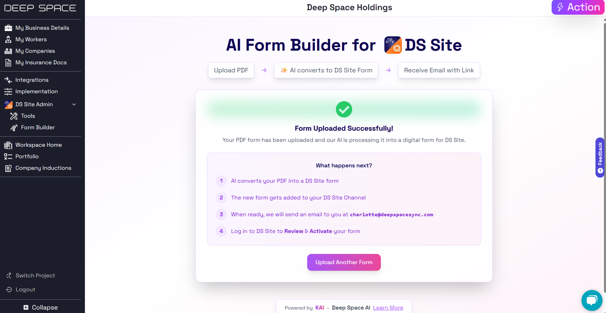{ loading=lazy }
  <figcaption>AIFormBuilderSuccess.png</figcaption>
</figure>

#### 📧 Email Notification
* Receive an email notification directly to your inbox when AI processing has completed, linking directly to the new form in your channel to review and activate

<figure markdown="span">
  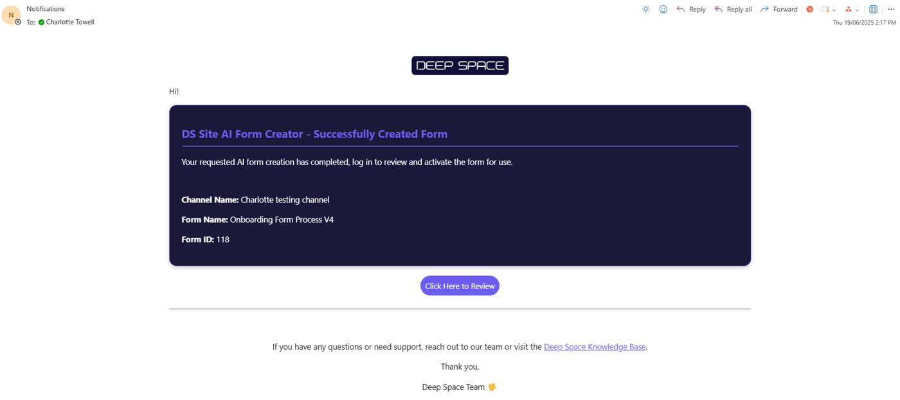{ loading=lazy }
  <figcaption>DSSiteFormEmail.png</figcaption>
</figure>

#### 🔄 Intelligent Conversion
* Powered by AI, Deep Space detects formatting, allowed values, and additional rules from a variety of PDF inputs, into the standardised DS Site Form structure

<figure markdown="span">
  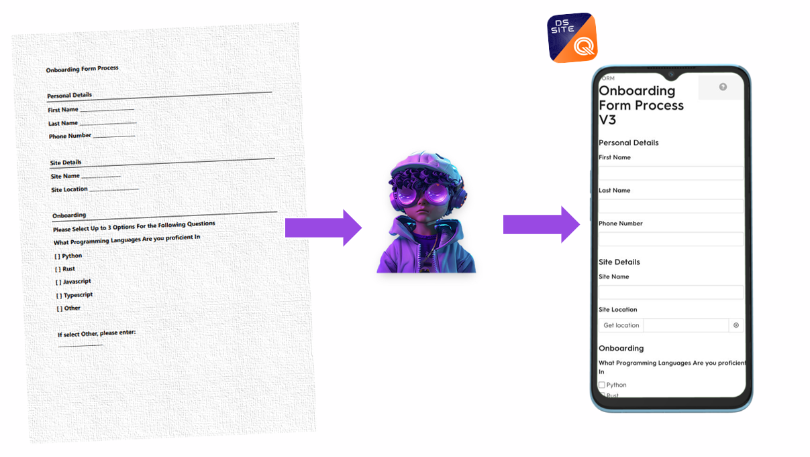{ loading=lazy }
  <figcaption>PDF-To-Form.png</figcaption>
</figure>

**Why Did We Build This?**

* Enable easier migration from other systems into DS Site
* Be system-agnostic by building a generic PDF parsing tool utilising AI
* Build the foundations for future AI-powered form development for DS Site

---

## Major WBS Improvements in Deep Space Actions { #cl-45923 }

DS Platform 18 Jun 2025 #45923 <button class="cl-copy" type="button" data-anchor="cl-45923" title="Copy a direct link to this entry">Copy link</button>

**Deep Space Actions** has been upgraded with a brand new **WBS (Work Breakdown Structure) View**, bringing more context to actions within your project.

#### 🗂️ Full WBS Hierarchy Layout
* Enable **WBS View** to full a dropdown layout of Actions within their assigned WBS
* Use the new **WBS filter** to configure your view
* New **Full Screen** view available to allow for a full interface for viewing and editing actions

<figure markdown="span">
  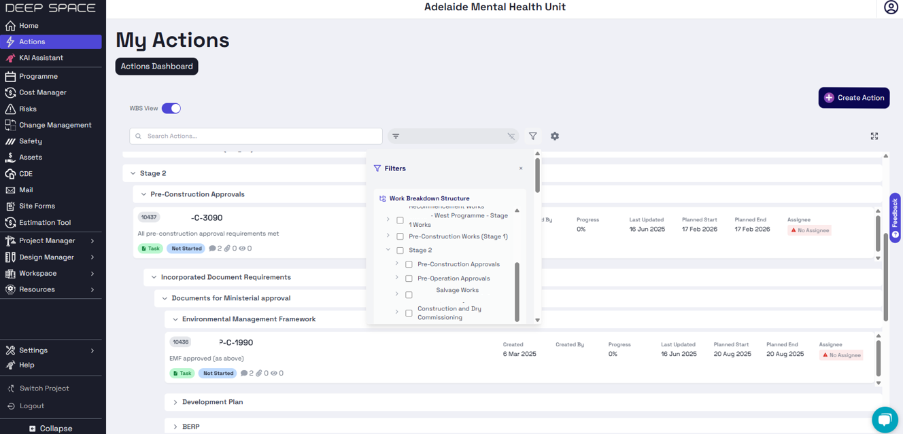{ loading=lazy }
  <figcaption>WBSActionsVie.png</figcaption>
</figure>

#### ✏️ Edit WBS Path in Details
* See the full WBS path against each action
* Ability to edit the hierarchy with search functonality

<figure markdown="span">
  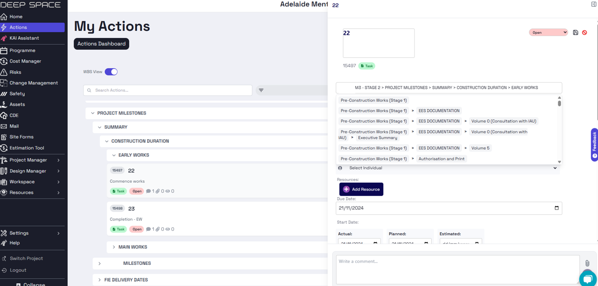{ loading=lazy }
  <figcaption>ActionsEditWBS.png</figcaption>
</figure>

#### 🛠️ Configure WBS in Admin Console
* View your full WBS hierarchy within the admin console
* Create new WBS, up to 3-levels deep
* Edit WBS to restructure your project

<figure markdown="span">
  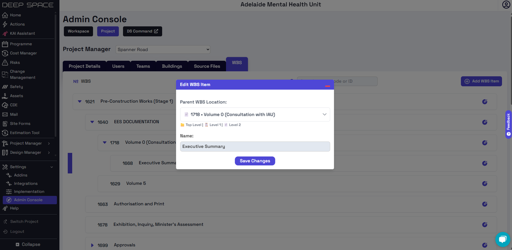{ loading=lazy }
  <figcaption>WBSAdminConsole.png</figcaption>
</figure>

**Why Did We Build This?**

* Continue bringing more programme functionality to Actions
* Improve Deep Space's WBS feature to support future integration with Cost Management
* Address a number of bug fixes for Actions

---

## 🧾 Introducing Cost Code Management – Build Better Project Structures { #cl-45921 }

DS Platform 16 Jun 2025 #45921 <button class="cl-copy" type="button" data-anchor="cl-45921" title="Copy a direct link to this entry">Copy link</button>

We’re excited to introduce the **Cost Code Management** in the Admin Console — a flexible, scalable foundation built to support your cost and budgeting (future module) workflows with ease and clarity.

!!! warning "Missing image · MISSING-IMG-45921-1"
    `cost code change log (1).png` has not been recovered yet. Original location: `https://storage.sleekplan.com/products/287727888/changelog/45921/inline-1bc55e29cd9309249448fcf802fa3d42.jpg`

#### ⚙️ Smarter Structure, Deeper Nesting  
- **Supports up to 3 levels** of nested cost codes — perfect for representing complex scopes of work  
- Freely **reorganize the hierarchy** by updating a cost code’s parent location  
- **Collapsible tree view** for easier browsing and visualization of your cost code structure  
- Designed for **clear alignment** with your budgeting and financial tracking processes  

!!! warning "Missing image · MISSING-IMG-45921-2"
    `cost code change log (2).png` has not been recovered yet. Original location: `https://storage.sleekplan.com/products/287727888/changelog/45921/inline-e74c916578ed92b8fca071c57ac48c07.jpg`

#### ✏️ Flexible Editing  
- Edit name, description, identifier, and hierarchy — anytime  
- Visual modals make updates intuitive and fast  
- Existing cost codes can be moved within the hierarchy with a single click  

!!! warning "Missing image · MISSING-IMG-45921-3"
    `cost code change log (3).png` has not been recovered yet. Original location: `https://storage.sleekplan.com/products/287727888/changelog/45921/inline-3e7ad7a368cb40ebd0bbc0ff16bdc683.jpg`

#### 🧩 Built for Budgeting  
- Designed to lay the groundwork for **future budgeting modules**  
- Enables mapping of cost codes to actual project line items  
- Helps teams track costs more precisely across different levels of delivery  

#### 🚀 Why Did We Build This?  
- Help teams set up a solid structure that will connect smoothly with upcoming budgeting features  
- Make it easier for project managers to organise and update how costs are tracked  
- Improve visibility of cost breakdowns across different stages and scopes of work  
- Get the platform ready for future updates that bring budgeting and finance tools together

---

## Unified Login for Navisworks Plugin { #cl-45838 }

DS Sync for Navisworks 14 Jun 2025 #45838 <button class="cl-copy" type="button" data-anchor="cl-45838" title="Copy a direct link to this entry">Copy link</button>

Our latest release of the Deep Space  **Navisworks** plugin now includes support for the new Deep Space Group login system.

!!! warning "Missing image · MISSING-IMG-45838-1"
    `2025-06-13 11.26.30.png` has not been recovered yet. Original location: `https://storage.sleekplan.com/products/287727888/changelog/45838/inline-ce38228931224b08589e31479acfb59f.jpg`

Download the latest versions by logging in to `Deep Space Platform > Settings > Addins`

#### 🔒 Single Sign On
* No need to remember a separate password for the plugins that now authenticate directly with your DS Platform or DS Site credentials.

#### 💼 Enterprise Login Support
* The plugins now support using your enteprise credentials to authenticate, if enabled for your business.

<figure markdown="span">
  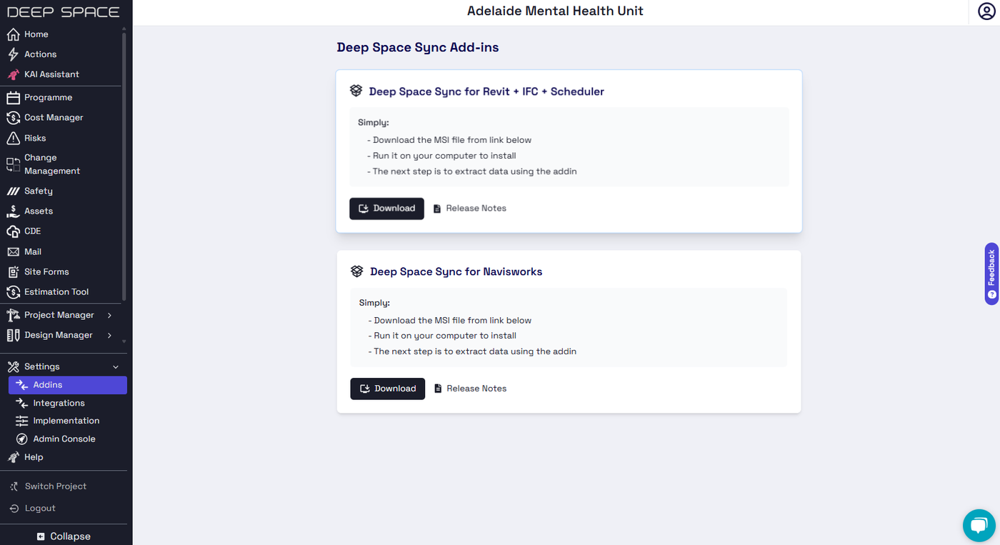{ loading=lazy }
  <figcaption>RevitNavisworksAddins.png</figcaption>
</figure>

**Why Did We Build This?**

* To complete the unification of the login system for the entire Deep Space Group ecosystem
* Improve security by using a dedicated authentication provider

---

## Unified Login System for Revit + IFC Plugins { #cl-45443 }

DS Sync for Revit 13 Jun 2025 #45443 <button class="cl-copy" type="button" data-anchor="cl-45443" title="Copy a direct link to this entry">Copy link</button>

Our latest release of the Deep Space **Revit + IFC**, and **Navisworks** plugin now includes support for the new Deep Space Group login system.

Download the latest versions by logging in to `Deep Space Platform > Settings > Addins`

#### 🔒 Single Sign On
* No need to remember a separate password for the plugins that now authenticate directly with your DS Platform or DS Site credentials.

#### 💼 Enterprise Login Support
* The plugins now support using your enteprise credentials to authenticate, if enabled for your business.

<figure markdown="span">
  { loading=lazy }
  <figcaption>RevitNavisworksAddins.png</figcaption>
</figure>

**Why Did We Build This?**

* To complete the unification of the login system for the entire Deep Space Group ecosystem
* Improve security by using a dedicated authentication provider

---

## Company Management Updates - Advanced DS Site Integrations + Dashboards { #cl-45759 }

DS Platform 11 Jun 2025 #45759 <button class="cl-copy" type="button" data-anchor="cl-45759" title="Copy a direct link to this entry">Copy link</button>

The **Company Management** console has received updates with a number of new features to support custom DS Site workflows & improve workspace manager visibility.

#### 📝 Supports Multiple Induction Checks
* You can now configure multiple induction status checks, mapped to your DS Site forms
* Flexibility to use different forms for different induction stages eg. onboarding, financial, safety
* Centralised view & filtering ability for all induction checks together
* Supported for both company-level and worker-level form submissions

<figure markdown="span">
  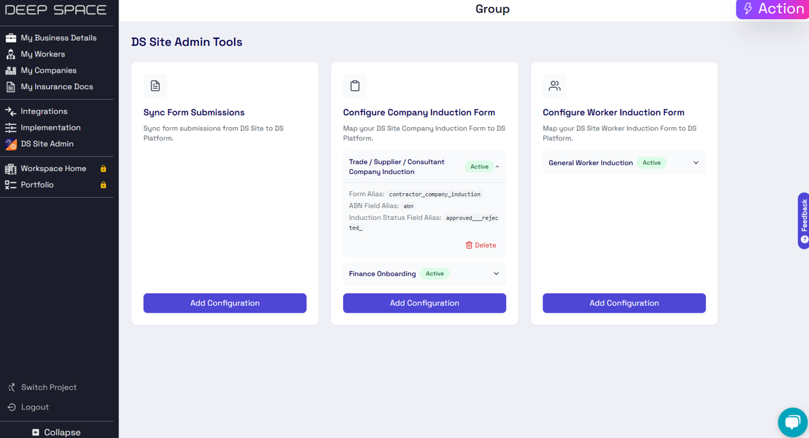{ loading=lazy }
  <figcaption>MultipleInductionStatusChecks.png</figcaption>
</figure>

#### 📊 View your Workspace Dashboards
* View our **Portfolio** and **Workspace Home** apps from within the Company Management console, for DS Pro customers
* Centralise your workspace-level reporting analytics, together with your vendor management

<figure markdown="span">
  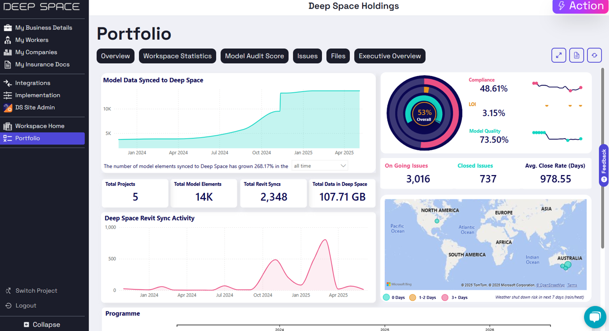{ loading=lazy }
  <figcaption>WorkspaceDashboardsCompanyManagement.png</figcaption>
</figure>

#### 🔄 Sync Historical Form Submissions
* In addition to our webhook integration for live syncing, you can now also request an on-demand form sync
* More control over which data is imported from DS Site to DS Platform
* Admin ability to sync complete records from entire channel history

<figure markdown="span">
  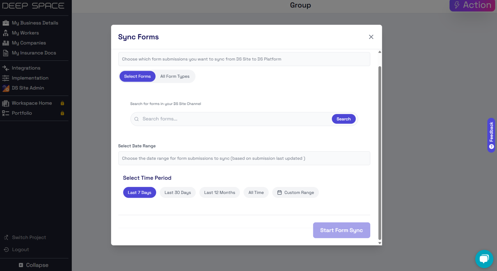{ loading=lazy }
  <figcaption>HistoricalFormSync.png</figcaption>
</figure>

**Why Did We Build This?**

* Support advanced custom workflows for induction checking
* Centralise workspace-level data in a single access point
* Support fluid onboarding of existing DS Site customers with seamless data syncing operations

---

## DS Site Integrations in DS Platform - View Company & Worker Inductions { #cl-44554 }

DS Site 6 Jun 2025 #44554 <button class="cl-copy" type="button" data-anchor="cl-44554" title="Copy a direct link to this entry">Copy link</button>

Deep Space now supports new integrations with **DS Site**, providing an improved interface to manage your on-site operations. View your vendors, workers, and inductions via custom integrations to your existing DS Site forms.

<figure markdown="span">
  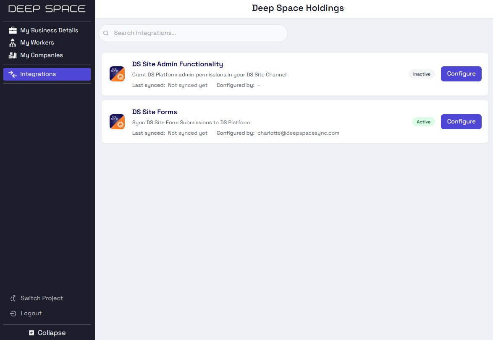{ loading=lazy }
  <figcaption>DSSiteIntegrations.png</figcaption>
</figure>

#### 💼 Custom Company Induction Status
* Integrates with any DS Site Form for your existing Company Induction workflows
* View induction status across companies in a centralised view
* Easily click to view the full form submission

> ℹ️ See our support article here for How to Configure Company Induction Status in Contractor Management

<figure markdown="span">
  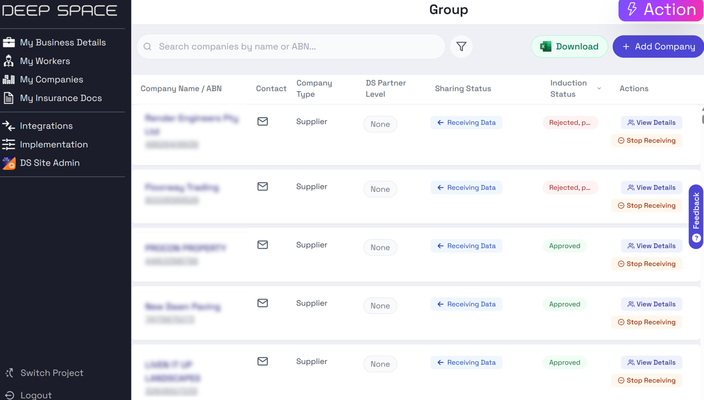{ loading=lazy }
  <figcaption>CompanyInductions.png</figcaption>
</figure>

#### 👷 Custom Worker Induction Status
* Integrates with any DS Site Form for your existing Worker Induction workflows
* View induction status in a centralised view, both for your workers & the workers of your vendor companies
* Easily click to view the full form submission

<figure markdown="span">
  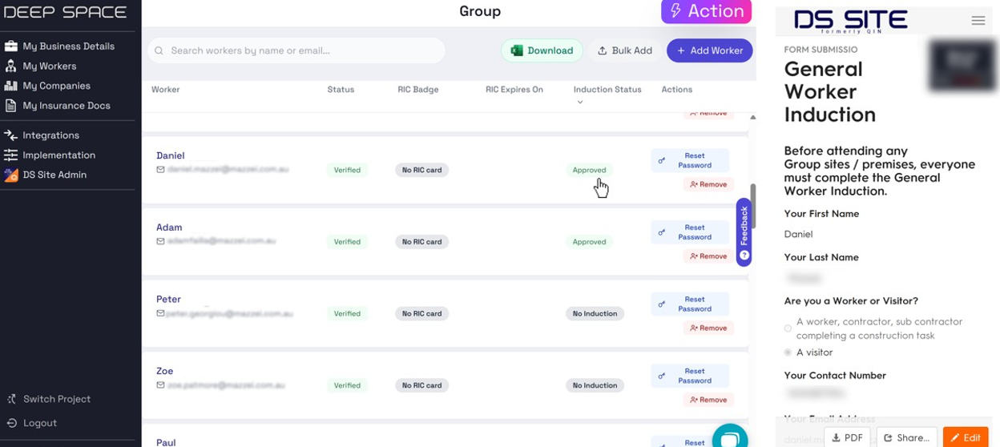{ loading=lazy }
  <figcaption>WorkerInductions.png</figcaption>
</figure>

#### 🔒 DS Site Admin Functionality
You can now securely provide admin access to Deep Space Platform of your DS Site Channel, allowing for enhanced automations & channel membership through the power of DS Pro. 

* Manage users from a central interface with our new [Contractor Management Platform](2025.md#cl-44652)
* Allow custom automations for extended channel capabilities such as the custom induction status automations.

> ℹ️ See our support article here for How to Configure DS Site Admin Functionality with Deep Space

<figure markdown="span">
  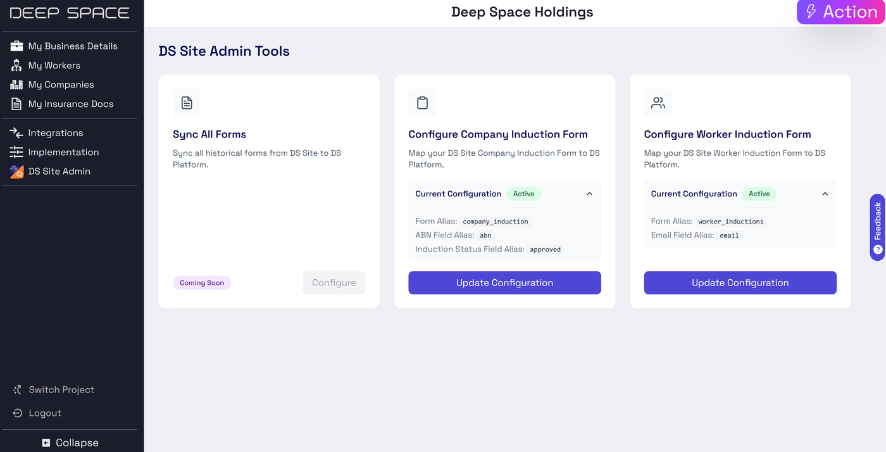{ loading=lazy }
  <figcaption>DSSiteAdminTools.png</figcaption>
</figure>

#### 📝 DS Site Form Submission Sync
Set up a form submission sync from your existing DS Site Channel into DS Platform for enhanced analytics, automations and AI enablement on your form data.

* Access a forms submission dashboard with DS Pro to view submission analytics
* Ask KAI, our AI Chatbot, about recent form submissions

> ℹ️ See our support article here for How to Configure DS Site Forms Sync

**Why Did We Build This?**

* Enable more data sharing between Deep Space's on-site & desktop solutions
* De-risk vendor & worker management by surfacing induction statuses in a centralised view
* Integrate seamlessly with existing workflows by enabling custom configurations
* Allow user control over sharing permissions across platforms
* Centralise management access into a more user-friendly interface

---

## Introducing Deep Space Hub - An Improved Web Experience🚀 { #cl-45569 }

DS Platform 4 Jun 2025 #45569 <button class="cl-copy" type="button" data-anchor="cl-45569" title="Copy a direct link to this entry">Copy link</button>

We're excited to roll out the **Deep Space Hub**!  Your new streamlined experience for managing projects, apps, and workflows - in a new and improved web platform!

!!! warning "Missing image · MISSING-IMG-45569-1"
    `DeepSpaceHubGIF.gif` has not been recovered yet. Original location: `https://storage.sleekplan.com/products/287727888/changelog/45569/inline-012bb0b2577249c19441f2b5c6177015.gif`

#### ⚡ Major Performance Improvements
- **One-time loading**: Key data loads once and remains accessible, even when switching between apps, projects, or views.  
- **Faster navigation**: Move between dashboards, teams, and tools without the need to reload everything from scratch.  
- **Reduced interruptions**: Background updates and intelligent syncing help avoid page refreshes or data loss.  
- **Scales with you**: Designed to handle more users and data as your team grows, without compromising speed. 

!!! warning "Missing image · MISSING-IMG-45569-2"
    `59b3c305db9d085753fe6af7e2abece.png` has not been recovered yet. Original location: `https://storage.sleekplan.com/products/287727888/changelog/45569/inline-0f882c6cc3fac9e8c2f09a29654c68bb.jpg`

#### 📈 Smoother UI
- **Smoother transitions**: Animations and interface flows are cleaner, making it easier to track what’s happening.  
- **Clearer layout**: Information is organized with better hierarchy and spacing for quicker understanding.  
- **Unified components**: Consistent design across all sections for a seamless experience.  
- **Responsive design**: Fully optimized for desktop and tablet — full mobile support coming soon.  
- **Fewer clicks**: Common actions are surfaced earlier so you can do more with less effort.

!!! warning "Missing image · MISSING-IMG-45569-3"
    `03ba5d139bb4e5efd60c3df2d6afe13.png` has not been recovered yet. Original location: `https://storage.sleekplan.com/products/287727888/changelog/45569/inline-f70632d1aaf1af683687b83c3e569e29.jpg`

#### 🧰 More Stablility, More Powerful Features  
- **More reliability**: Built with a robust framework, the new site is less prone to crashes, broken links, or unexpected errors.  
- **Supports advanced features**: Whether it's user authentication, dynamic forms, real-time content updates, or search filters — everything just works.  
- **Better file handling**: Uploads, downloads, and PDF previews are faster and more secure.  
- **Consistent performance across pages**: No matter where you go on the site, speed and functionality remain consistent. 
- **Future-proof**: Built to grow — these updates make it possible for our development team to ship new updates faster, so we can continue to deliver more value.

**Why Did We Build This?**

* To provide a centralised web platform for Deep Space users, allowing more integration between previously isolated features
* Deliver a fullly updated website addressing historical bug fixes & performance improvements
* Enable faster development & testing to ship new features faster
* Introduce more robust security and permissioning to the platform
* Support future growth and upcoming feature additions

---

## Create Deep Space Actions from your Inbox 📧 { #cl-45550 }

DS Platform 2 Jun 2025 #45550 <button class="cl-copy" type="button" data-anchor="cl-45550" title="Copy a direct link to this entry">Copy link</button>

You can now create Actions directly from your inbox, just by forwarding an email to Deep Space!

Simply add **-createaction** to your project correspondence logging address, and Deep Space will convert your email into a task, and auto-assign it to the sender.

<figure markdown="span">
  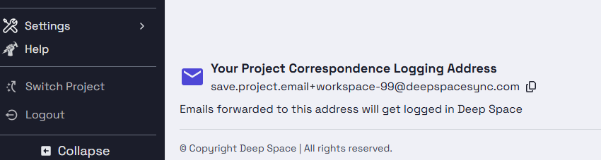{ loading=lazy }
  <figcaption>ProjectCorrespondenceLoggingAddress.png</figcaption>
</figure>

#### Also captures all attachments!
🔗 Deep Space saves all email attachments to the CDE and links them to the Action so all context is captured

**Why Did We Build This?**

* To save time by automating action creation from emails
* Avoid information loss by creating tasks from otherwise lost email chains

---

## Deep Space Actions in Contractor Management { #cl-45284 }

DS Platform 30 May 2025 #45284 <button class="cl-copy" type="button" data-anchor="cl-45284" title="Copy a direct link to this entry">Copy link</button>

Deep Space Actions is now available within our new [Contractor Management Platform](2025.md#cl-44652), bringing the power of the **Actions Engine** to your Company Management.

#### ⚡Company-wide Actions
* Create & view company-wide actions
* Track your workspace implementation progress in Deep Space with **Implementation Actions**
* Assign actions to workers in your company
* Link actions to your insurance documents

<figure markdown="span">
  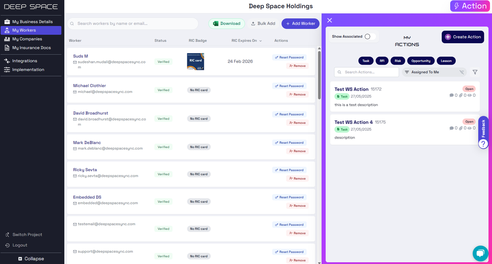{ loading=lazy }
  <figcaption>WorkspaceLevelActions.png</figcaption>
</figure>

**Why Did We Build This?**

* Bring the power of Deep Space Actions to the Contractor Management Platform
* Utilise the Actions Engine for streamlined implementation task status tracking

---

## DS Site Badge Sharing Feature Release { #cl-44714 }

DS Site 26 May 2025 #44714 <button class="cl-copy" type="button" data-anchor="cl-44714" title="Copy a direct link to this entry">Copy link</button>

### New Feature: Badge Sharing Across DS Site Channels

We’ve added powerful new functionality to enhance how badges are shared and managed across channels. This update introduces new capabilities for both **users** and **administrators**.
You can now view shared badges users have been awarded in other channels, enhancing collaboration and visibility across teams.

#### 🧑‍💻 For Users
* **Share Awarded Badges to Other Channels**
	Users can now go to their profile, select an awarded badge, and share it with other channels. The list of shareable channels is pre-defined by administrators as a whitelist per badge type.
* **User-Friendly Sharing Interface**
	A dropdown allows users to choose from available whitelisted channels. After confirmation, the badge becomes visible in the selected channel.
* **In-App Badge Sharing Support**
	The sharing functionality is now available in both the web and app UIs, ensuring a consistent experience across platforms.

!!! warning "Missing image · MISSING-IMG-44714-1"
    `3391748218374_.pic_hd copy.jpg` has not been recovered yet. Original location: `https://storage.sleekplan.com/products/287727888/changelog/44714/inline-6fe1b407155e179fba4942001438bcf7.jpg`

#### 🛠️ For Administrators
* **Manage BadgeType Whitelists**
	Admins can define which channels each badge type can be shared to. This is done via the badge type edit modal with full add/remove capabilities.

	!!! warning "Missing image · MISSING-IMG-44714-2"
	    `3401748222245_.pic copy.jpg` has not been recovered yet. Original location: `https://storage.sleekplan.com/products/287727888/changelog/44714/inline-225a9213d20d2505c154c73bce7776c5.jpg`

* **Badge Visibility Control**
	Sharing is now restricted to the channels defined in the whitelist. Attempts to share outside the allowed list are prevented via built-in validation.
* **Extended Search for Awarded Badges**
	The Awarded Badges admin UI now includes:
	* 	Badges originally awarded in the channel
	* 	Badges shared into the channel from other sources
	* 	Clear distinction between awarded vs. shared badges in the UI
* **Advanced Filtering Options**
	Two new filters have been added to the Awarded Badges page:
	* “Shared From” – Filter by the source channel a badge was shared from.
	* “Shared To” – Filter badges that have been shared from the current channel to another specified channel.

#### Why Did We Build This?

* Enable centralised control over badge sharing across channels.
* Ensure badges are only shared to appropriate destinations through admin-defined whitelists.
* Improve visibility of achievements while maintaining governance and data integrity.

---

## Deep Space Contractor Management Platform Launch { #cl-44652 }

DS Pro for Construction 22 May 2025 #44652 <button class="cl-copy" type="button" data-anchor="cl-44652" title="Copy a direct link to this entry">Copy link</button>

Deep Space has now released our **Contractor Management** platform - a new centralised interface, making it easy to manage & minimise risk on your projects, integrated directly with the [Deep Space Contractor Network](https://www.deepspacegroup.ai/deep-space-network).

### 👷‍♂️ My Workers
**A central hub to view all your workers across Deep Space**

* Instantly identify risks by viewing each worker’s RIC (Residential Induction Card) status, ensuring safety compliance.
* Approve or deny user requests to join your company.
* Easily bulk import workers using a customisable CSV format—seamlessly integrate with your existing systems.

<figure markdown="span">
  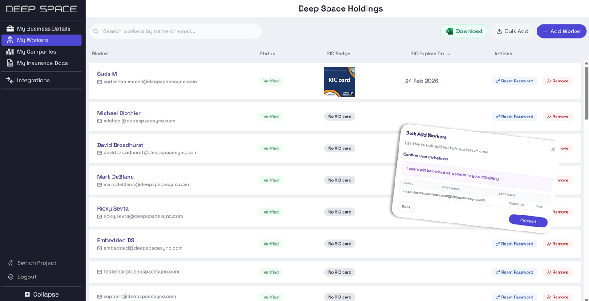{ loading=lazy }
  <figcaption>MyWorkers.png</figcaption>
</figure>

### 🏗️ My Companies
**Securely manage and share company data with your trusted vendors.**

* Easily add companies from the Deep Space Contractor Network.
* B2B trust relationships to give you control over data sharing.
* View vendor workers, their induction status, and insurance documents at a glance.

<figure markdown="span">
  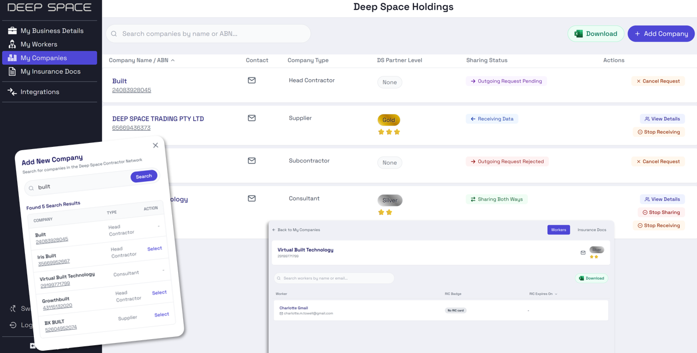{ loading=lazy }
  <figcaption>MyCompanies.png</figcaption>
</figure>

### 📄My Insurance Docs
**Track your insurance documents and monitor expiry dates easily.**

* Securely upload your insurance documents to the Deep Space CDE
* Integrated permissions layer to ensure only you & your approved vendors can see your documents
* **Coming Soon ✨**: Automated expiry notifications

<figure markdown="span">
  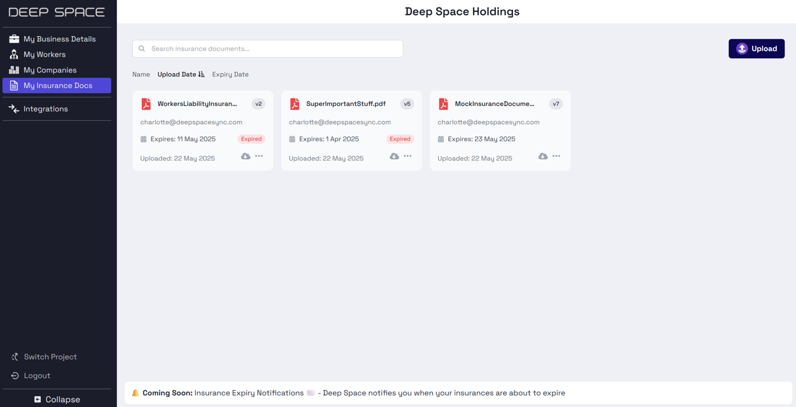{ loading=lazy }
  <figcaption>MyInsuranceDocs.png</figcaption>
</figure>

**Why Did We Build This?**

* Provide a centralised management location for worker and subcontractor oversight
* Reduce the risk of missed inductions or expired insurances.
* Enhance accountability across all parties through trusted data-sharing relationships

---

## Model Audit Commenting via Deep Space Actions { #cl-44342 }

DS Pro for Design 20 May 2025 #44342 <button class="cl-copy" type="button" data-anchor="cl-44342" title="Copy a direct link to this entry">Copy link</button>

Deep Space Actions now supports adding **comments** to specific discipline line items in the **Model Audit app**, directly integrated with your project's **Execution Plan Compliance Report**

> 💡 Check out or **knowledge base** article for more info: here

#### 🗨️ Easily Add Comments
Click on items in the compliance report to

* See existing actions & comment history
* Create new actions to start a thread
* Connect other actions with model audit results

<figure markdown="span">
  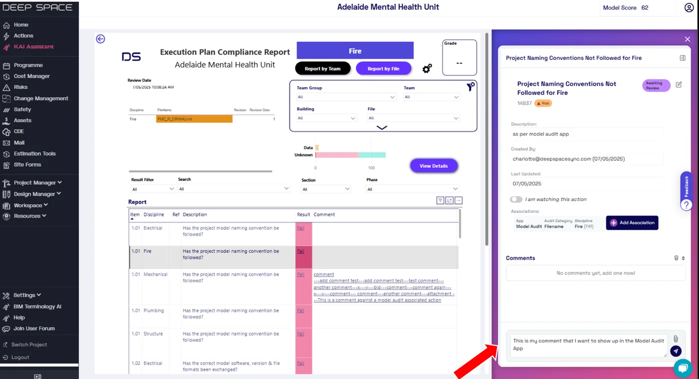{ loading=lazy }
  <figcaption>undefined-May-08-2025-01-51-46-8818-AM.webp</figcaption>
</figure>

#### 📊 View Comments in the App
* Model Audit app auto-refreshes when a comment is added to keep data up to date
* See all comments directly in-line in the table
* Supports exporting full comment history with your model audit results

<figure markdown="span">
  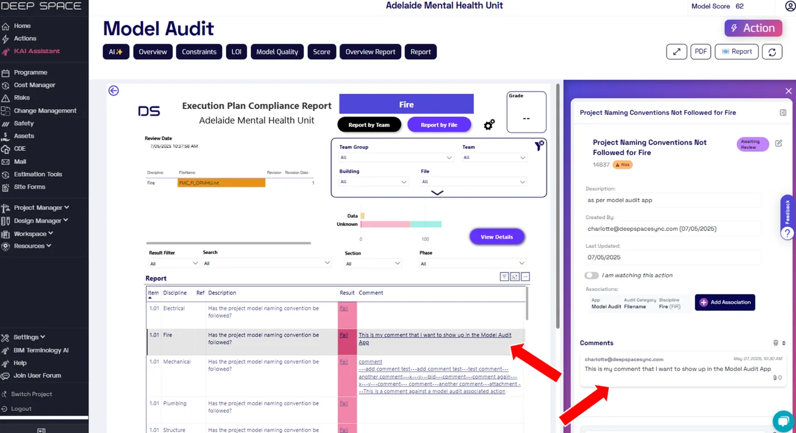{ loading=lazy }
  <figcaption>undefined-May-08-2025-01-51-54-5445-AM.webp</figcaption>
</figure>

**Why Did We Build This?**

* Replace the legacy comments integration for Model Audit
* Support new commenting features like attachments for the Model Audit App
* Improve user experience by allowing comments to be added directly from the actions panel

---

## Model Audit App Updates - New Automated Checks + Project Customisation Options { #cl-44344 }

DS Pro for Design 19 May 2025 #44344 <button class="cl-copy" type="button" data-anchor="cl-44344" title="Copy a direct link to this entry">Copy link</button>

The Model Audit app has been updated with new audit checks + ways to customise its use for your project.

#### ✅ New Audit Checks
A number of new automated audit checks has been added - calculating results from your synced model data.

* Does a Start View exist?
* Do ANY Design Options exist?
* File has NO embedded Image files?
* File has NO CAD files attached?
* Correct units and accuracy are applied
* Check for disconnected elements
* Model File Size Does Not Exceed 1gb
* File contains specifically named view for export
* File has NO embedded PDF files?
* File is Detached from Central
* Phase Filter Visibility is correct
* Sub weight for not connected warnings

#### 🏗️ Project-Specific BIM Requirements
You can now configure specific BIM requirements at the project-level, as well as across your workspace, supporting unique reporting needs for certain projects.

#### 📊 New Visuals + Scoring Functionality
A number of visual updates + backend scoring improvements to provide clearer results - driving you towards action to improve your model score.

<figure markdown="span">
  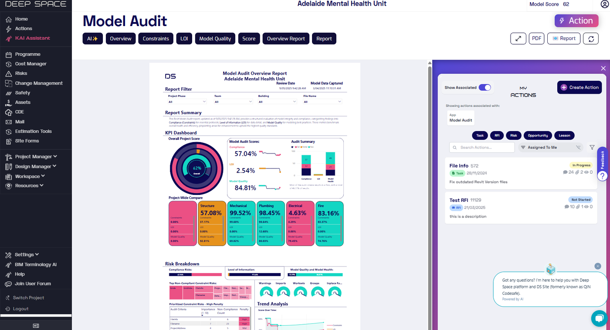{ loading=lazy }
  <figcaption>ModelAudit.png</figcaption>
</figure>

**Why Did We Build This?**

* Add more checks to the Model Audit app to ensure better quality scores
* Support project-level customisation to meet unique BIM reporting needs

---

## Programme App Updates - Spotlight Feature + WBS Hierarchy { #cl-44343 }

DS Pro for Construction 15 May 2025 #44343 <button class="cl-copy" type="button" data-anchor="cl-44343" title="Copy a direct link to this entry">Copy link</button>

Deep Space's **Programme** recently received two new feature updates to improve your scheduling workflows!

#### 💡 Spotlight Tasks
Similar to other programming tools, you can now set a date range to **spotlight** tasks in the Programme dashboard, clearly highlighting what tasks overlap the date period.
Combined with our due date filter, create **powerful**, **custom** views to analyse your upcoming work.

#### 🔗 View WBS Hierarchy
The new **matrix view** allows an enhanced view of WBS hierarchy in your programme, painting a clearer picture of where tasks belong.

<figure markdown="span">
  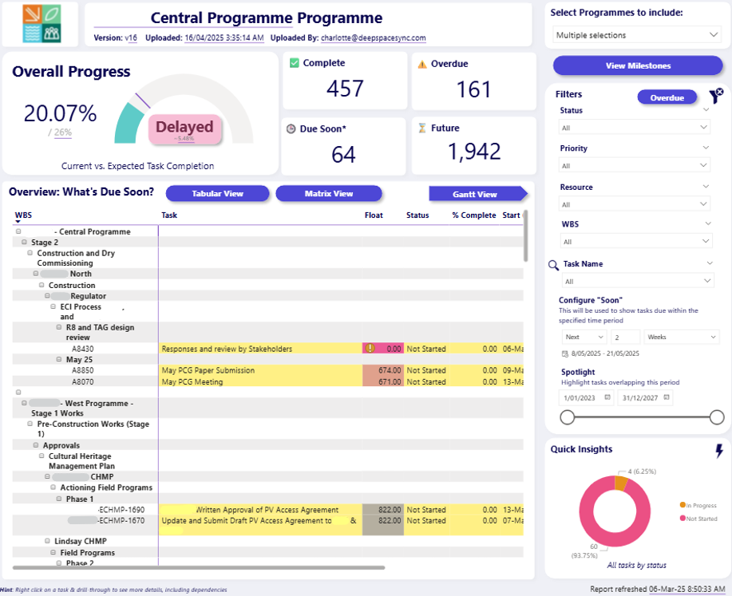{ loading=lazy }
  <figcaption>SpotlightProgramme.png</figcaption>
</figure>

**Why Did We Build This?**

* Improve usability of the Programme App by supporting more programme-native features

---

## Deep Space Subcontractor & Cost Management { #cl-44341 }

DS Pro for Construction 12 May 2025 #44341 <button class="cl-copy" type="button" data-anchor="cl-44341" title="Copy a direct link to this entry">Copy link</button>

Deep Space has released its newest suite of tools - **Cost Management**, supporting financial workflows, claim processes & better cost tracking on your projects.

### 💸 End-to-End Financial Workflow Management
* Manage Purchase Orders, Variation Orders, Claims, Invoices & Variation Requests in one unified system
* Track a full history of cost items through the approval stages
* Support for attaching documents to centralise relevant financial data

<figure markdown="span">
  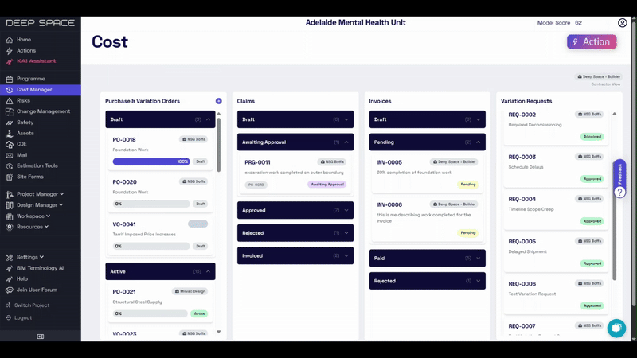{ loading=lazy }
  <figcaption>CostGIF.gif</figcaption>
</figure>

### ✅ Smart Approval Workflows
* Streamlined approval processes for claims, invoices, and variation requests
* Approved variation requests instantly convert to variation orders
* Invoices can be generated directly from claims with pre-filled information, saving time & ensuring accuracy

<figure markdown="span">
  { loading=lazy }
  <figcaption>ApprovalWorkflows.png</figcaption>
</figure>

### 👁️ Integrated with Your Organization
* A new dedicated permission to manage which users can access sensitive financial data
* Works with your existing team and company structure, defining subcontractor & contractor roles
* Smart visibility so subcontractors only see items assigned to them
* Clear identification of issuing and receiving companies for each transaction

<figure markdown="span">
  { loading=lazy }
  <figcaption>DeepSpaceCostPermissions.png</figcaption>
</figure>

### 🔔 Notifications & Status Tracking
* Smart notifications ensure the right person is notified of relevant changes
* Track payment status from creation through to approval and payment
* Monitor due dates to stay on top of payment schedules

<figure markdown="span">
  { loading=lazy }
  <figcaption>CostNotificiations.png</figcaption>
</figure>

### 📊 Financial Visibility
* Track amounts, currencies, and payment statuses across all financial records
* Monitor remaining amounts on orders and budget impacts
* View work start/end dates and claim periods
* Track who created, modified, and approved each financial record

**Why Did We Build This**

* To provide an easy-to-use tool to manage the complete financial workflow in your construction projects
* Alleviate the frustrations of complicated and non-user-friendly alternatives
* Centralise cost data with other project management functions in a single platform
* Create a more transparent financial process between all project stakeholders

---

## ACC Document Metadata Integration Released { #cl-44340 }

DS Pro for Design 9 May 2025 #44340 <button class="cl-copy" type="button" data-anchor="cl-44340" title="Copy a direct link to this entry">Copy link</button>

Deep Space now syncs Revit document metadata from **Autodesk Construction Cloud**, easily configurable from our **Integrations** page.

!!! warning "Missing image · MISSING-IMG-44340-1"
    `ACC Cloud Documents Metadata.png` has not been recovered yet. Original location: `https://storage.sleekplan.com/products/287727888/changelog/44340/inline-a7bf72e51b71d120eddf74029996ab17.jpg`

#### 🔎 Enhanced Metadata in Model Audit
Superseding our legacy integraton, you can now directly  use your ACC credentials to sync data to appear in the Model Audit app such as revision status & dates.

!!! warning "Missing image · MISSING-IMG-44340-2"
    `ModelAuditRevisionDates.png` has not been recovered yet. Original location: `https://storage.sleekplan.com/products/287727888/changelog/44340/inline-def2ad125d43e05ce18cf1147c8167b2.jpg`

#### ✨ Easy to Configure
Simply visit the **Integrations** page, click configure & log in to ACC. Deep Space then performs daily syncs of your data!

**Why Did We Build This?**

* To supersede a legacy ACC integration, using our new authentication method
* Provide visibility into cloud RVT revisions from ACC in the Model Audit App

---

## Implementation Checklist Released { #cl-43568 }

DS Platform 30 Apr 2025 #43568 <button class="cl-copy" type="button" data-anchor="cl-43568" title="Copy a direct link to this entry">Copy link</button>

We're excited to roll out the **Implementation Checklist**, making it easier to track your project implementation and ensure you're unlocking the full potential of Deep Space.

You can now access a clear, centralized view of which Deep Space workloads have been configured for your project — and what’s left to implement. Think of it as your project’s readiness tracker, built to drive faster value realization and better outcomes.

#### ✅ Track what’s already configured
See at a glance which workloads are active in your project.

#### 📈 Identify what’s missing 
Discover additional features that can enhance boost your project's productivity.

#### 📚 Access setup guidance instantly 
Integrated help articles are just a click away, making next steps easy and actionable.

!!! warning "Missing image · MISSING-IMG-43568-1"
    `implementation_checklist.png` has not been recovered yet. Original location: `https://storage.sleekplan.com/products/287727888/changelog/43568/inline-55125c90838526ec7283e2604169488a.jpg`

 
**Why Did We Build This?**

* Provide visibility into currently configured Deep Space workloads
* Encourage implementation to get the most value out of projects
* Centralise help articles for key set-up steps

---

## Manage Source Files & Buildings in the Admin Console { #cl-43112 }

DS Platform 9 Apr 2025 #43112 <button class="cl-copy" type="button" data-anchor="cl-43112" title="Copy a direct link to this entry">Copy link</button>

We're excited to announce several important updates to the Admin Console in Deep Space, aimed at streamlining your management tasks and enhancing your daily workflow.

#### Source Files 📁
We've launched a dedicated Source File page for better management of your files.

* Easily update file attributes, such as names, disciplines, buildings and more.
* Clearly organized layout for quick navigation and management.

!!! warning "Missing image · MISSING-IMG-43112-1"
    `图像 (1).png` has not been recovered yet. Original location: `https://storage.sleekplan.com/products/287727888/changelog/43112/inline-6ef8fc0d32c168968fb1fc72a2e10774.jpg`

#### Buildings 🏢
Introducing the Building page, where you can now easily create, edit, and manage your buildings.

* Add new buildings directly through a straightforward interface.
* Edit existing building details quickly and efficiently.

!!! warning "Missing image · MISSING-IMG-43112-2"
    `图像 (2).png` has not been recovered yet. Original location: `https://storage.sleekplan.com/products/287727888/changelog/43112/inline-788f5bdee212d983062c31957f63e98f.jpg`

#### Batch Management for Source Files 📦
Manage multiple files at once, significantly reducing the time spent on repetitive tasks

* Select multiple source files and apply bulk updates effortlessly.
* Quickly modify shared attributes to streamline your workflow.

!!! warning "Missing image · MISSING-IMG-43112-3"
    `图像.png` has not been recovered yet. Original location: `https://storage.sleekplan.com/products/287727888/changelog/43112/inline-f9d07f3348e6ea2bf818ff58e226d276.jpg`

#### Why Did We Build This
* Add more project configuration capabilities to the admin console
* Boost productivity by making batch updates quicker and easier.

---

## Admin Console Update Released! { #cl-42818 }

DS Platform 31 Mar 2025 #42818 <button class="cl-copy" type="button" data-anchor="cl-42818" title="Copy a direct link to this entry">Copy link</button>

We're happy to share the latest improvements to the Admin Console in Deep Space, aimed at making your workflow smoother and your experience better.

#### Faster Loading ⚡
Enjoy quicker load times, reducing delays and helping you get things done faster.

#### Improved Toast Notifications 🍞
Receive clear and immediate feedback through new toast notifications, indicating whether actions succeeded or if something needs your attention.

* Notifications appear at the top-right corner when tasks start and finish.
* Different types of tasks will show distinct notifications.

<figure markdown="span">
  { loading=lazy }
  <figcaption>518c8e7425bb4603f76f724c82f3a3c.png</figcaption>
</figure>

#### Enhanced Multitasking 🔄
Work on multiple tasks simultaneously, making it easier to handle various activities efficiently.
Yes, you can now perform multiple operations concurrently without waiting for previous tasks to complete.

#### Revamped UI & Smooth Animations 🎨
Navigate easily with a refreshed, user-friendly interface complemented by smooth, intuitive animations.

<figure markdown="span">
  { loading=lazy }
  <figcaption>bfc0c833233d8c56468e0e4c29ad8fe.png</figcaption>
</figure>

#### Powerful Sorting & Filtering 🔍
Quickly sort and filter your data, making it easy to find exactly what you need.

* Workspace Manager: Sort and filter options for projects, users. Sort option for companies.  
* Project Manager: sort and filter options for user. Sort option for teams.

#### Robust Field Validation ✅
All input fields are validated before submission, ensuring accuracy and security of your data.

#### Seamless Workspace & Project Switching 🔀
Move smoothly between different workspaces and projects while previous tasks continue running in the background.

#### Why Did We Build This?
* Save valuable time by reducing wait periods and increasing responsiveness.
* Improve your productivity by managing multiple tasks at once.
* Stay instantly updated and reduce uncertainty with clear notifications.
* Benefit from an easier, more intuitive interface that enhances your daily operations.
* Find exactly what you need faster, streamlining your management tasks.
* Gain peace of mind with improved security and fewer data entry errors.
* Enjoy smoother navigation across your projects and workspaces, helping you maintain focus and efficiency.

---

## My Actions ⚡ - Personalised Actions Management Interface { #cl-42547 }

DS Platform 24 Mar 2025 #42547 <button class="cl-copy" type="button" data-anchor="cl-42547" title="Copy a direct link to this entry">Copy link</button>

Deep Space Actions now has a new **management interface**, with a **customised** view per user to focus on what's important to you!

#### ⚡My Actions
Introducing **My Actions**, a dedicated full-screen interface designed for seamless task management at scale. No more juggling between different views—everything you need is now in one place.

<figure markdown="span">
  { loading=lazy }
  <figcaption>My Actions.png</figcaption>
</figure>

#### 🎯Personalised Views & Permissions
We've introduced smarter filtering so you can cut through the noise and focus on what’s most relevant. Switch between:

* **Assigned to Me / My Team** – Stay on top of what needs your attention
* **Created by Me / My Team** – Track progress on your initiatives
* **I'm Watching** – Keep an eye on critical actions
* **Assigned as Resource** – Stay informed on where you're contributing

Ensure security by ensuring users only see actions relevant to them, and be across it all as a Project Manager.

<figure markdown="span">
  { loading=lazy }
  <figcaption>MyActionsFilters.png</figcaption>
</figure>

#### ⏩Performance Upgrades
We’ve made the entire actions experience **faster** with major backend improvements. Adding comments, updating actions, and creating associations now happen asynchronously, keeping things smooth and uninterrupted—so you can stay focused on getting things done.

#### + Quality of Life Improvements ✨
* Enable & disable columns to customise your view
* Filter & sort to find what you need
* Filter out system comments to only see what's relevant

#### Why Did We Build This?
* Create a productive interface for actions management at scale
* Filter out the noise by providing personalised filters
* Improve the usability of Actions for programme management use-cases

---

## New Authentication Provider: SSO & MFA Support in Deep Space { #cl-42524 }

DS Platform 24 Mar 2025 #42524 <button class="cl-copy" type="button" data-anchor="cl-42524" title="Copy a direct link to this entry">Copy link</button>

We're excited to announce the release of our new authentication provider, bringing improved security and new login capabilities to the Deep Space platform.

#### 🌎 Unified Access for DS Site & DS Platform
This update provides a foundation for a more unified login experience across all Deep Space services in the future.

#### 💼 Enterprise Single Sign-On (SSO)
Deep Space now supports Single Sign-On, allowing you to log in directly using your organization's login credentials. Please see this support article to set up SSO  or [reach out to us](mailto:devs@deepspacesync.com).

#### 🔒 Multi-Factor Authentication (MFA)
For an added layer of security, we've introduced optional Multi-Factor Authentication, allowing users to set up an extra layer of security

#### Why Did We Build This?
* Enhance security in Deep Space by using a third-party authentication provider.
* Offer SSO & MFA for our users.
* Integrate user login details between the DS Site and DS Platform.

---

## Import Change Orders to Deep Space: New App { #cl-42446 }

DS Pro for Construction 19 Mar 2025 #42446 <button class="cl-copy" type="button" data-anchor="cl-42446" title="Copy a direct link to this entry">Copy link</button>

Stop critical project variation data from getting buried in email chains and scattered storage folders—Deep Space now enables spreadsheet uploads for **Change Orders**, making them easily accessible in a central dashboard.

#### 🔄 Digitise Spreadsheet Data
* Convert change register spreadsheets into an interactive dashboard for streamlined tracking
* Maintain full version history across all uploads for transparency and accuracy

#### ⚡ Collaboration via Actions
* **Comment, assign tasks, and link** change order rows to other project data
* Keep everything connected within Deep Space via Actions Associations

#### Why Did We Build This?
* Promote data transparency by surfacing change order details in a central dashboard
* Eliminate silos by integrating change orders with other project data using Deep Space Actions

---

## PDF or Image Imports: New Automated Model Audit Checks { #cl-42218 }

DS Pro for Design 7 Mar 2025 #42218 <button class="cl-copy" type="button" data-anchor="cl-42218" title="Copy a direct link to this entry">Copy link</button>

Deep Space's **Model Audit** app has been updated with new checks to provider greater insight into Model Health, following Revit best practises.

#### 🔗 Are all Imports Linked?
* Automatically detect if **PDF**, **Image**, and **CAD** imports are linked, giving your team suggestions for BIM best practises

<figure markdown="span">
  { loading=lazy }
  <figcaption>ImportsCheck.png</figcaption>
</figure>

#### 📊 Dashboard View
* Drill-down into details via the **Imports** page to see exactly which elements in your models are flagging
* Roll up into a high-level score across files and disciplines to visualise **Model Health** from a management view

<figure markdown="span">
  { loading=lazy }
  <figcaption>importsSummary.png</figcaption>
</figure>

#### 📂 Revit Links
* View Revit Links in your model to better understand file dependencies and external references

<figure markdown="span">
  { loading=lazy }
  <figcaption>RevitLinks.png</figcaption>
</figure>

#### Why Did We Build This?
* Expand the capability of Model Audit to enable better Model Health validation

---

## Deep Space CDE: Centralised Cloud-Based Storage for Your Project Documents { #cl-42142 }

DS Platform 5 Mar 2025 #42142 <button class="cl-copy" type="button" data-anchor="cl-42142" title="Copy a direct link to this entry">Copy link</button>

We’re excited to announce **Deep Space CDE**, a powerful new way to upload, store, and collaborate on your previously scattered project files in a centralised cloud environment.

#### 🌍 Centralised Access
* Promote **data democracy** on your project by storing files in one shared location
* Prevent lost **knowledge** and **time** wasted searching across multiple sources - access everything from a single-unified platform
* Access **advanced insights** and **AI-powered analytics** as we integrate Deep Space CDE with [KAI](https://www.deepspacegroup.ai/kai), our project management agent

<figure markdown="span">
  { loading=lazy }
  <figcaption>CDE_overview.png</figcaption>
</figure>

#### 🔄 Consistent Versioning
* Forget confusing naming conventions like `_v1_2_final_FINAL_lastone` by storing all versions in the CDE
* Always access the latest version with a **clear version history**
* Retireve past versions whenever needed

<figure markdown="span">
  { loading=lazy }
  <figcaption>CDE_versions.png</figcaption>
</figure>

#### ⚡ Integrate With Actions
* CDE integrates directly with Deep Space Actions bringing all of its **collaborative features** to your document storage
* Add [comments](2025.md#cl-40176), assign RFIs, and receive [notifications](2025.md#cl-40399) about your documents
* Create **connections** between your documents and other project data via [Actions Associations](2025.md#cl-41303)

<figure markdown="span">
  { loading=lazy }
  <figcaption>CdeActions.png</figcaption>
</figure>

#### 🔐 Secured By Google Cloud
* Built on Google Cloud, ensuring world-class **security**, **reliability**, and **accessibility**
* **Regional data tenancy** to support compliance and regualtory requirements

#### Why Did We Build This?
* Centralized, intelligent file storage—reduce silos and improve collaboration.
* Enhance static documents with Deep Space Actions for real-time teamwork.
* Unlock hidden value by integrating project files with other Deep Space data sources.
* Support upcoming AI features in Deep Space for advanced document analsysis.

---

## Programme Functionality for Actions: WBS, Planned/Actuals & More { #cl-42045 }

DS Platform 4 Mar 2025 #42045 <button class="cl-copy" type="button" data-anchor="cl-42045" title="Copy a direct link to this entry">Copy link</button>

Deep Space Actions now has more programme functionality that works **out of the box**, giving you better tools to **prevent delays** and manage your project's schedule. You can view your Acions data in the **Programme** app for an executive view of your Deep Space Actions.

#### 🛠️ WBS Support for Actions
WBS support is now added to Actions, allowing for more intuitive project breakdowns. WBS from your P6 programme is auto-extracted on upload.

#### 🗓️ Planned, Actual & Estimate Dates
Get clearer insight into task status with **planned**, **actual**, and **estimated** dates, allowing the project team to provide timely updates of potential delays or extensions.

!!! warning "Missing image · MISSING-IMG-42045-1"
    `planned_actuals.png` has not been recovered yet. Original location: `https://storage.sleekplan.com/products/287727888/changelog/42045/inline-b622387ebdaae22b031c5dd5c0c9a985.jpg`

#### 🔍 Better task visibility
Additional fields such as % complete are now available for more granular status updates against tasks.

!!! warning "Missing image · MISSING-IMG-42045-2"
    `percent_complete_gif.gif` has not been recovered yet. Original location: `https://storage.sleekplan.com/products/287727888/changelog/42045/inline-301cdd04df1eb6a978d1607fc1943e86.gif`

#### Why Did We Build This?
* For more clarity on task status, allowing early risk or delay detection
* Expand the use case of Actions to become a data-driven programme tool
* Save time and prevent errors by automating data extraction, triggered by data uploads

---

## Resource Support for Actions { #cl-41983 }

DS Platform 28 Feb 2025 #41983 <button class="cl-copy" type="button" data-anchor="cl-41983" title="Copy a direct link to this entry">Copy link</button>

Our latest update introduces **Resources** to Deep Space Actions, enhancing project management by allowing you to allocate resources to actions for better tracking, planning, and execution.

#### ⚡ Automated Resource Creation from Your Programme
* **The Programme → Actions Automation** now creates not just actions, but also their corresponding resources

#### 🔗 Map Resources to Deep Space Teams & Companies
* Built-in support to map resources back to users, teams & companies, integrating with your existing project hierarchy
* Resources mapped to users will benefit from the Actions notification system

#### ⏳ Coming Soon
This is just the first release for resources with more features on the roadmap:

* **Resource workload tracking:** Assign availability & time consumption to analyse workload balance and resource overlaoding
* **Resource hierarchies:** Capture complex project systems by nesting resources to define your hierarchy
* **Dynamic Visbility & Permissions:** Use resources to determine who has visibility to view & edit actions
* **Resource management console:** Manage all project resources from a centralised location
> & many more features to enhance Deep Space Actions as a programme management tool

#### Why Did We Build this?
* Enhance the functionality of Deep Space Actions as a data-powered programme tool
* To refine action assignments, distinguishing between assigned users and attached resources
* Set up Resources in Deep Space for future integrations like Cost

---

## Programme App Updates: Executive Overview, Resourcing & Critical Path { #cl-41798 }

DS Pro for Construction 24 Feb 2025 #41798 <button class="cl-copy" type="button" data-anchor="cl-41798" title="Copy a direct link to this entry">Copy link</button>

Deep Space's programme app has been updated again, focusing on providing a project manager with the tools to stay informed & ahead of schedule.  

#### 📊 Executive Overview  
* **High-level visibility** into programme health, tailored for an executive audience  
* **Multiple programme view** for a summarised, cross-programme perspective  
* **Critical path insights** to identify current and upcoming delay risks  
* **Resourcing analytics** to quickly pinpoint overloaded teams  

<figure markdown="span">
  { loading=lazy }
  <figcaption>programme-exec-overview.png</figcaption>
</figure>

#### ⚖️ Cross-Programme Resource Management  
* **Overloading detection** across multiple programmes to uncover hidden risks  
* **Time-based analytics** to discover and fix future overloading periods before they occur  

<figure markdown="span">
  { loading=lazy }
  <figcaption>programme-resourcing.png</figcaption>
</figure>

#### 🚨 Critical Path Risk Analysis  
* **Automated critical path calculation** when uploading your programme  
* **Early warnings** for delayed tasks at risk of becoming critical  

<figure markdown="span">
  { loading=lazy }
  <figcaption>programme-critical-path.png</figcaption>
</figure>

#### Why Did We Build This?  
* Make programme insights accessible at an executive level  
* Improve visibility into delay risks using critical path analysis  
* Provide resource analysis tools to manage workloads across programmes

---

## Variations App Updated To Support Better Summarisation and More than 2 Milestones { #cl-41757 }

DS Pro for Construction 21 Feb 2025 #41757 <button class="cl-copy" type="button" data-anchor="cl-41757" title="Copy a direct link to this entry">Copy link</button>

It can be really hard to check quantities from BIM files over time. Not anymore! With Deep Space, you simply:

1. Sync data from Revit, IFC or Navisworks
2. Create Project Milestones
3. Open the Variations App

You can compare 2 or more moments in time, and generate detailed summaries of specific trades like Structural Steel.

!!! warning "Missing image · MISSING-IMG-41757-1"
    `quantities.png` has not been recovered yet. Original location: `https://storage.sleekplan.com/products/287727888/changelog/41757/inline-8709b69c4257d22aba0f76823868c1f9.jpg`

**Why Did We Build This?**

* Quickly get evidence needed to request a Variation from your Client
* Compare data across multiple model types (Revit and IFC), which is traditionally difficult
* Compare quantities over time

---

## Create Actions From Your Data with KAI { #cl-41422 }

KAI 19 Feb 2025 #41422 <button class="cl-copy" type="button" data-anchor="cl-41422" title="Copy a direct link to this entry">Copy link</button>

Why stop at just **searching** your data, when AI can **act** on it for you! KAI, our AI project management agent, is now *action-packed* 😉

#### ⚡AI-Generated Actions
KAI now helps you create actions instantly based on your conversation. Using AI-generated field population, your actions are pre-filled with relevant details.

* **Auto-Linked Data:** KAI can use our new [Actions Associations](2025.md#cl-41303) feature to link the data in your conversation with actions
* **Edit Actions:** KAI can also help you edit existing action fields

#### 💬 Add Comments
You can now add comments to existing actions directly through KAI, ensuring smooth communication without switching contexts.

#### 💡 Full Transparency: Know What's AI-Generated
All project AI-enhanced action interactions are marked with a ✨ (sparkle), giving you full visibility into AI use while tracking who’s using AI to boost productivity.

<figure markdown="span">
  { loading=lazy }
  <figcaption>AddCommentToActionGIF.gif</figcaption>
</figure>

#### Why Did We Build This?
* Create opportunities for AI-enhanced collaboration through Deep Space Actions.
* Widen the functionality of KAI to enable users to interact seamlessly with their data.
* Save time by automating manual data entry with AI.

---

## Tracking Workflow Updates - Custom Statuses & More { #cl-41672 }

DS Platform inferred 18 Feb 2025 #41672 <button class="cl-copy" type="button" data-anchor="cl-41672" title="Copy a direct link to this entry">Copy link</button>

Deep Space's **Tracking** workflows allow you to upload disjointed spreadsheets and perform automations to link your **tracking data** back to your **models**. Automatically produce an XML search-set, usable in Navisworks or Revizto to create a 3D visualisation of your tracking statuses against your model.

The engine running this workflow recently received an update to support even more configuration options.

#### ✨ Custom Status Support
* In addition to Deep Space's auto-generated statuses based on tracking dates, we now also support using *custom statuses* based on your tracking data
* Upload a file with your custom statuses, and Deep Space can map them back to the element GUID, so you can visualise in Revizto

#### 📊 Dashboard Updates
* The **Track app** has been updated with a fresh look, providing a more intuitive interface
* Data auto-refreshes after each new upload
* The Workflow Upload form has also been updated to only accept valid file types, improving user experience

#### ⚡ Actions Integration
* Using our [Actions Associations](2025.md#cl-41303) feature, you can create actions directly linked to tracked elements to support team collaboration against your tracking data

<figure markdown="span">
  { loading=lazy }
  <figcaption>tracking.png</figcaption>
</figure>

> Contact Deep Space to configure your tracking workflow

#### Why Did We Build This?
* Support more use cases with our tracking workflow, allowing custom statuses to be used
* To create a reusable automation to process any spreadsheet column, mapped back to model data
* Improve UX in the Track app & workflow uploading process

---

## New App: Autodesk Coordination - Your ACC & BIM360 Issues in Deep Space { #cl-41584 }

DS Pro for Design 14 Feb 2025 #41584 <button class="cl-copy" type="button" data-anchor="cl-41584" title="Copy a direct link to this entry">Copy link</button>

Introducing our latest app, **Autodesk Coordination**! You can now sync your coordination issues from ACC & BIM360 directly to Deep Space and view analytics in the new dashboard.

### 📈 Trending Analytics
* At a glance, see how your project is tracking for open, closed, and ongoing issues over time
* Identify possible delays  & bottle-necks within your coordiantion data

!!! warning "Missing image · MISSING-IMG-41584-1"
    `AutdeskCoordination.png` has not been recovered yet. Original location: `https://storage.sleekplan.com/products/287727888/changelog/41584/inline-10a0fa373e526a093e0a07da63e89354.jpg`

### 💼 Integrated Teams
* Our integration links directly with Deep Space teams, allowing customised views into assigned users, disciplines, and companies
* Improve accountability on your project by providing visibility into issue assignees

!!! warning "Missing image · MISSING-IMG-41584-2"
    `Teams.png` has not been recovered yet. Original location: `https://storage.sleekplan.com/products/287727888/changelog/41584/inline-52560e85b40f17a6e7d49de60f6f05cc.jpg`

> See our knowledgebase article here for how to set up your ACC or BIM360 integration with Deep Space to start using the Autodesk Coordination app

#### Why Did We Build This?
* **Improved Accountability**: Provide a view for the whole project team into coordination progress
* **More data sources**: Our autodesk issues integration continues to grow your project data network in Deep Space, bringing together more sources of truth

---

## Feature Release: Create Dependencies between Actions { #cl-41556 }

DS Platform 13 Feb 2025 #41556 <button class="cl-copy" type="button" data-anchor="cl-41556" title="Copy a direct link to this entry">Copy link</button>

Following the release of [**Actions Associations**](2025.md#cl-41303), we're improving Deep Space Actions yet again with **Dependency Associations**! ⚡

Now, you can define **blocking/blocked-by** relationships between your actions, bringing more structure and precision to **schedule management** natively within Deep Space.

Taking associations a step further, your project data network evolves—first through links between **your data and actions**, and now through **links between actions** themselves, defining your project’s workflow with greater clarity, all backed by data.

!!! warning "Missing image · MISSING-IMG-41556-1"
    `action_dependencies_visual.png` has not been recovered yet. Original location: `https://storage.sleekplan.com/products/287727888/changelog/41556/inline-fbec6a623488776661e3e4603c33754e.jpg`

#### What else is new?
* 🔗**Easily navigate dependencies**: View and manage related actions directly from the actions panel with a single click
* 📝 **Improved task management**: Introducing new statuses: *Not Started*, *In Progress*, & *Awaiting Review* for more granular control and collaborative visibility

<figure markdown="span">
  { loading=lazy }
  <figcaption>916eea22bb88e81e34c51762d20e7b15_2.JPG</figcaption>
</figure>

---

## Programme Updates - Expanded App Functionality & Improved P6 Integration { #cl-41485 }

DS Pro for Construction 12 Feb 2025 #41485 <button class="cl-copy" type="button" data-anchor="cl-41485" title="Copy a direct link to this entry">Copy link</button>

The **Programme** app has been getting some big enhancements behind the scenes lately, including a new app layout to make managing your programme easier in Deep Space!

### ⚡ Automate Programme Tasks → Actions
* When you upload a programme into Deep Space, we convert programme tasks into *actions*, allowing for quicker collaboration and change tracking! Click on a task in the dashboard and instantly collaborate via comments in the Actions Panel.

!!! warning "Missing image · MISSING-IMG-41485-1"
    `Programme.png` has not been recovered yet. Original location: `https://storage.sleekplan.com/products/287727888/changelog/41485/inline-a63b8f6f791ba00965aa333e3aeba6db.jpg`

### 📊 Updated Dashboard
* **Streamlined Overview**: Select your required timeframe to see upcoming tasks & quick insights
* **See Dependencies**: Click a task and see predecessor and successor tasks to identify any schedule blocks
* **New Gantt View**: Check out our experimental feature to get an enhanced Gantt chart view of your schedule

!!! warning "Missing image · MISSING-IMG-41485-2"
    `Gantt.png` has not been recovered yet. Original location: `https://storage.sleekplan.com/products/287727888/changelog/41485/inline-cd0b5b8a1ad073c60125d20f89788560.jpg`

### 🗓️ Improved P6 Integration
* Our P6 integration now extracts even more data into Deep Space, including task dependencies, resources, WBS, and more

#### Why Did We Build This?
* Widen functionality of Deep Space Actions via action associations and action dependencies
* Develop the tool to automate any uploaded data into actions
* Enable easy collaboration on programme data in Deep Space that works out of the box on upload
* Improve the value of the Programme app by introducing views that support scheduler workflows

---

## Feature Release: Actions Associations - Data Connections Made Easy! { #cl-41303 }

DS Platform 7 Feb 2025 #41303 <button class="cl-copy" type="button" data-anchor="cl-41303" title="Copy a direct link to this entry">Copy link</button>

⚡ Announcing the newest enhancement to the Deep Space Actions Engine: **Actions Associations!**

Associations empower you to connect *any* data source to *any* other, creating a dynamic, interconnected network unique to your project.  Think of it as a living map of your data, where every piece of information can trigger action and reveal valuable relationships.

!!! warning "Missing image · MISSING-IMG-41303-1"
    `Add Association.gif` has not been recovered yet. Original location: `https://storage.sleekplan.com/products/287727888/changelog/41303/inline-092164c665ae5cc355787d6706844a6f.gif`

Simply click on any data point within Deep Space and select "**Add Association**."  The real magic happens when you connect multiple sources to the same action, establishing powerful connections between previously disparate data.

Check out [this demo](https://app.storylane.io/share/tg2lbaovvzwx) to see it happen! Or log in to your project & start creating associations now!

#### Why Did We Build this?
* **Simplify Complex Workflows:**  Streamline your processes by automating actions based on data connections.
* **Drive Action:**  Every piece of data can now prompt action, ensuring no valuable information is overlooked.
* **Boost Collaboration:**  Enable seamless collaboration by making data connections transparent and accessible to your team.
* **Unlock Lost Value:**  Break down data silos and extract the full potential of your information by connecting everything together.

---

## KAI Alpha Release - AI Chatbot { #cl-41220 }

DS Platform 3 Feb 2025 #41220 <button class="cl-copy" type="button" data-anchor="cl-41220" title="Copy a direct link to this entry">Copy link</button>

We recently announced the alpha version of KAI, an AI-powered construction project management assistant, connected directly to your project data.

#### 📊 Project Data Search
Find what you need instantly

- Search spreadsheets, databases and custom data
- Answer questions with pinpoint accuracy
- Save hours on manual data searches

#### 📧 Email Integration
Stay on top of your inbox

- Summarise and preview project emails
- Track deadlines and action items
- Never miss a critical update

#### 📃 Document Management
Your documents organised and accessible

- Search plans, specs and reports
- Extract key information in seconds
- Simplify Common Data Environment (CDE) tasks

#### ..more!

More features & improvements are being added each day. Visit [here](https://www.deepspacegroup.ai/kai) to sign up for early access.

#### Why Did we Build This?
* To streamline access to your project data via a natural language interface
* Allow deeper insights & connections between data sources
* Enhance the efficiency of decision-making workflows powered by data

---

## DS Sync for Revit and IFC - Version 1.7.57 { #cl-40956 }

DS Sync for Revit 22 Jan 2025 #40956 <button class="cl-copy" type="button" data-anchor="cl-40956" title="Copy a direct link to this entry">Copy link</button>

### Revit Improvements:
* collect Sheet parameters
* bug fixes and performance improvements

### IFC Improvements
Added Support for

* IfcBuildingStorey
* IfcProject
* IfcSite parameters
* IfcBuilding parameters
* IfcBuildingStorey parameters
* IfcGrid
* IfcFacility
* IfcMarineFacility

---

## Deep Space Sync for Navisworks 1.0.2 Released { #cl-40955 }

DS Sync for Navisworks 22 Jan 2025 #40955 <button class="cl-copy" type="button" data-anchor="cl-40955" title="Copy a direct link to this entry">Copy link</button>

We have released our Deep Space plugin for Navisworks 2020-2025 and it is available from the Addins menu. You can also [download the latest version here](https://cdn.deepspacesync.com/DeepSpaceSyncInstallerForNavisworks.msi).

### Features
* sync Elements and Element data
* sync Parameters
* sync Clashes to Deep Space Coordination
* switchback capability
* create file structure from complicated Navisworks hierarchies
* regional support
* fast data ingestion

### What Did We Build This?
While many projects use more modern coordination tools, Navisworks remains the benchmark. It is also often still mandated as a deliverable.

By creating a Navisworks add, we provide a fast and easy way to extract all metadata from all your models, and also sync the Clashes to determine coordination status.

---

## Personalised Email Notifications - Project Updates Straight To Your Inbox { #cl-40399 }

DS Platform 14 Jan 2025 #40399 <button class="cl-copy" type="button" data-anchor="cl-40399" title="Copy a direct link to this entry">Copy link</button>

We’ve just released a significant enhancement to how you stay informed about your projects! Here's what’s new:

#### Personalised Project Updates 📧
Introducing a new **personalised project update**, combining the best of the previous actions & project summary emails into one informative notification.

* **Your Actions:** See a high-level summary of only actions relevant to you
* **Project Updates:** Stay up to date with the latest project work in Deep Space including the latest data and activity
* **Key Insights:** Get a snapshot of notable KPIs to inform your project progress
* **Delivered Straight to Your Inbox:** Tailored updates ensure you save time and stay informed with the information that matters most.

#### Changes to Actions Emails ⚡
* **For Discipline Leads Only:** The old actions emails will be sent exclusively to Discipline Leads, providing a comprehensive overview of all actions for their area.
* **Access for All Users:** To view all actions, simply log in to Deep Space and use the new, intuitive [Actions UI](2025.md#cl-40176).

### Why Did We Build This?
* Extract more value out of insights straight to your inbox
* Encourage engagement with Deep Space for all project users to maximise project collaboration
* Streamline communication by providing a single unified email per project

---

## Risk Register Collaboration in Deep Space { #cl-40173 }

DS Pro for Construction 6 Jan 2025 #40173 <button class="cl-copy" type="button" data-anchor="cl-40173" title="Copy a direct link to this entry">Copy link</button>

Introducing our new Risks App! An easy way to upload your risk register to view & collaborate on in Deep Space.

#### Spreadsheet Import 🗂️
* A flexible back-end means it is easy to configure and upload complex spreadsheet formats containing risk registers to store in Deep Space
* Store multiple versions to keep track of history
* Supports multiple different registers on a single project

#### Intuitive Interface 🔍
* A user-friendly way to view risks in a centralised dashboard and drill-down into related data
* Quick search across all risks in your project
* Access analytics about risks in your project

#### Enhanced Collaboration 💬
* Supported by recent updates to Deep Space Actions, you can create actions from risks and add comments or attachments
* A single point of truth for project users to view the latest risk versions

### Why Did We Build This?
* Simplify Risk Register management and sharing on a project
* Unify project risk registers with Deep Space detected risk actions
* Allow for enhanced collaboration based on risks, such as commenting
* Increase the amount of project data in Deep Space to learn & predict project insights, supporting future AI development

---

## Deep Space Actions - Comments & UI Update { #cl-40176 }

DS Platform 3 Jan 2025 #40176 <button class="cl-copy" type="button" data-anchor="cl-40176" title="Copy a direct link to this entry">Copy link</button>

Over the break, we released a significant update to Deep Space Actions - changing the way you can collaborate on your project! ⚡

#### Add Comments to Actions 💬
* Actions now supports commenting, allowing for enhanced collaboration and opening discussion
* Add attachments to comments which upload directly to your project's Deep Space document store

#### Fresh UI 📱
* We have created a fresh look for the Actions panel, blending seamlessly with your in-app experience in Deep Space
* Access actions & comments easily while viewing an app
* Context-awareness ensures you only see actions related to the selected data in your dashboard

#### + more ✨
* Actions can now be assigned to individual users, or disciplines
* You can now "watch", or add watchers to an action to stay notified of updates
* Multiple attachments, in several file types, can now be added to both an action, or action comment
* Enhanced search capabilities & filters for finding specific actions with ease

### Why Did We Build This?
* To enhance the power of Deep Space actions in being used for project collaboration
* Improve the user experience when creating & viewing actions within apps
* Integrate with the Deep Space CDE (document store) to save all project files

---
