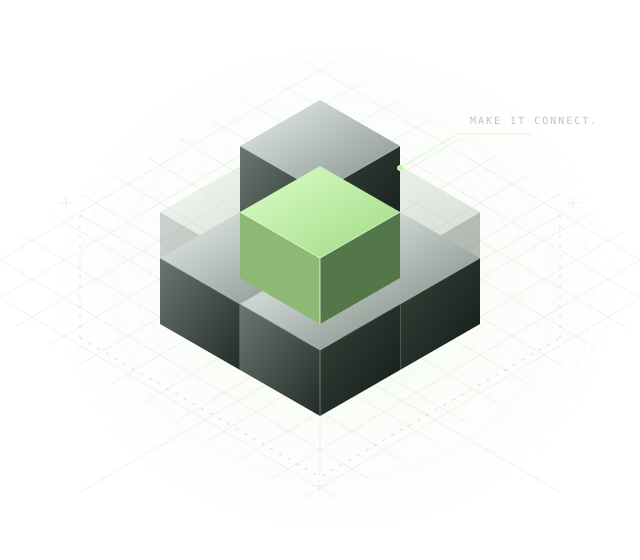

<section class="bg-hero" aria-labelledby="home-title">
  

    
 Independent tools. Connected thinking.

    <h1 id="home-title">Good tools. Great work.</h1>
    
Software for the people moving construction forward. From Revit automation to project intelligence, we turn complex work into clear next steps.

    

      <a class="bg-button bg-button-primary" href="projects/shadowgrid/">Explore ShadowGrid ↗</a>
      <a class="bg-button bg-button-secondary" href="#our-tools">Find your next tool ↓</a>
    

    
Built and hosted by Black Grid.

  

  

    
BLACK GRIDCONNECT THE PIECES

    
    
MODELS / DATA / PEOPLE+

  

</section>

  Revit automationConstruction intelligencePractical AIProject delivery

<section class="bg-feature" aria-labelledby="shadowgrid-feature">
  

    
01 / In the spotlight

    <h2 id="shadowgrid-feature">Your workflow. On the ribbon.</h2>
    
ShadowGrid for Autodesk Revit

    
Less time repeating yourself. Run purpose-built automation from a dedicated Revit tab, with script packs that grow alongside your team's work.

    <a class="bg-text-link" href="projects/shadowgrid/">Meet ShadowGrid ↗</a>
  

  

    
SGSmall scripts. Big difference.01—03

    <ol class="bg-workflow-list">
      <li>01
<strong>Select &amp; filter</strong>
Get the right elements, ready for the next step.

↗</li>
      <li>02
<strong>Tag &amp; check</strong>
Apply the rules. Find what needs attention.

↗</li>
      <li>03
<strong>Clean &amp; repeat</strong>
Turn recurring model work into repeatable tools.

↗</li>
    </ol>
    
REVIT 2023—2025NO ADMIN RIGHTS NEEDED

  

</section>

<section class="bg-tools" id="our-tools" aria-labelledby="tools-title">
  

    

02 / The Black Grid toolkit
<h2 id="tools-title">A tool for the next step.</h2>

    
Built around real work. Explore what fits yours.

  

  

    <a class="bg-product-card bg-product-card-wide" href="ds-pro/">
      
DSConstruction intelligence↗

      <h3>Deep Space</h3>
Connect model data, field teams and project operations in one construction operating system.

      
DS ProDS HarmonyDS Horizon

      Explore the platform →
    </a>
    <a class="bg-product-card" href="projects/client-implementation-board/">
      
CB↗

      
Client collaboration
<h3>Client Implementation Board</h3>
A clear, secure view of the work moving your implementation forward.

      See how it works →
    </a>
    <a class="bg-product-card" href="projects/pmgrid/">
      
PM↗

      
AI-assisted project management
<h3>PM Grid</h3>
Projects, tasks and context, connected in a workspace built for the way you think.

      Explore PM Grid →
    </a>
    <a class="bg-product-card" href="projects/proxp/">
      
PX↗

      
Professional portfolios
<h3>ProXP</h3>
Your project experience, backed by the people who were there with you.

      Discover ProXP →
    </a>
    <a class="bg-product-card" href="projects/mytendrils/">
      
mt↗

      
AI conversation capture
<h3>mytendrils</h3>
Keep the useful part of the conversation. Capture your AI work and send it to email.

      Meet mytendrils →
    </a>
    <a class="bg-product-card" href="projects/bg-mem/">
      
bg↗

      
Memory for AI
<h3>bg-mem</h3>
Context that outlasts a session. A durable memory layer, on infrastructure you own.

      Explore bg-mem →
    </a>
  

</section>

<section class="bg-journal" aria-labelledby="journal-title">
  

03 / Ideas from the field
<h2 id="journal-title">What Revit Wants.</h2>
Luke Johnson on Revit, BIM, construction technology and the tools changing how we work.

  <a class="bg-button bg-button-secondary" href="https://wrw.is/">Read the journal ↗</a>
</section>

BLACK GRIDBuilt for the work ahead.<a href="#home-title">Back to top ↑</a>

