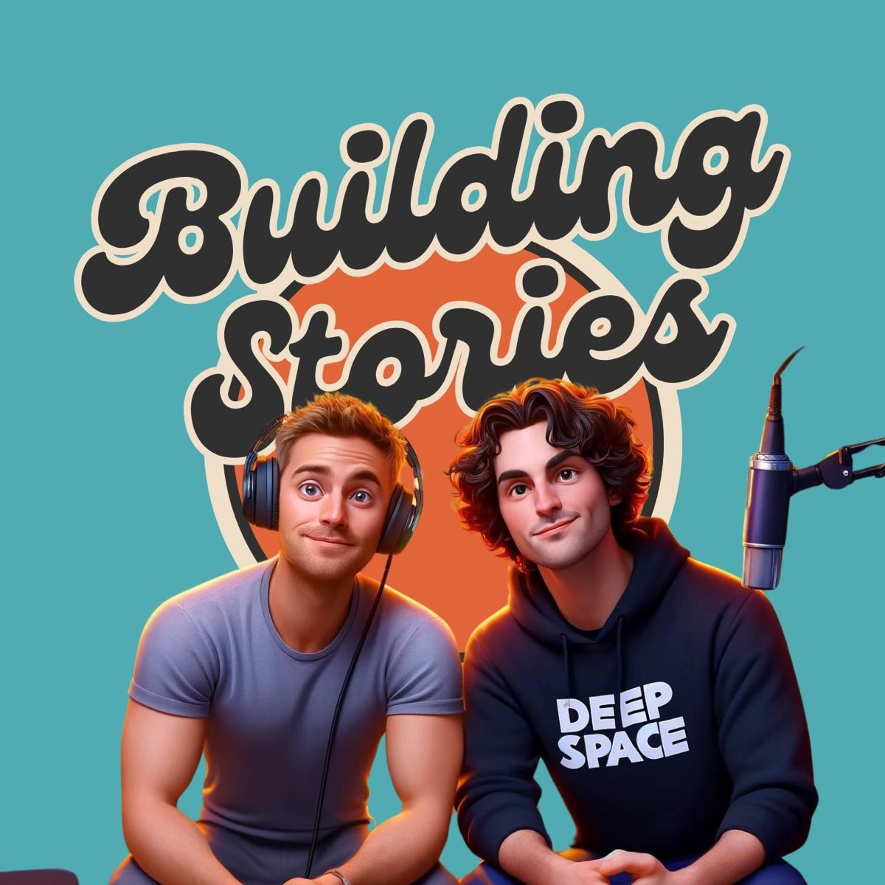
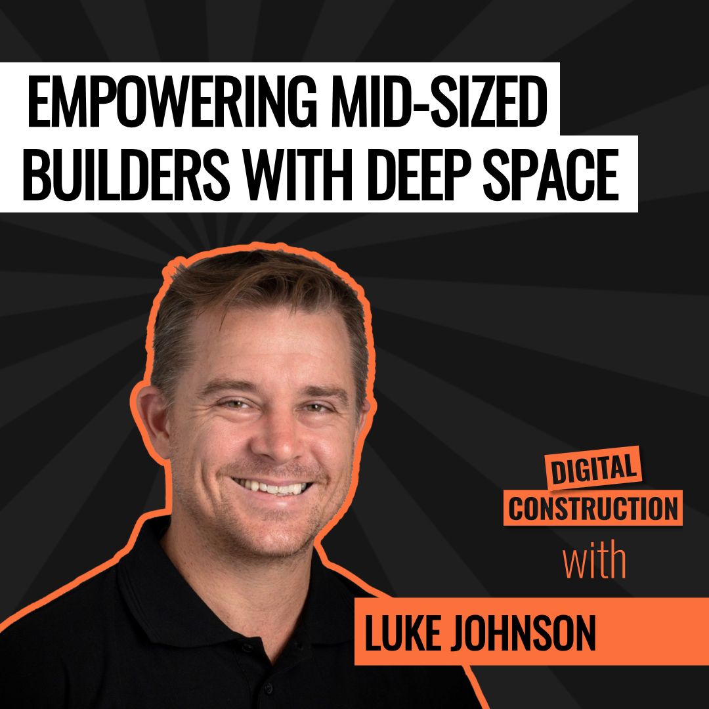
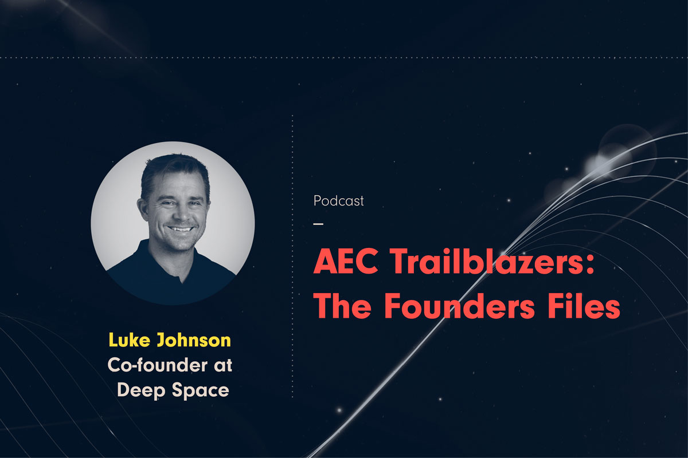
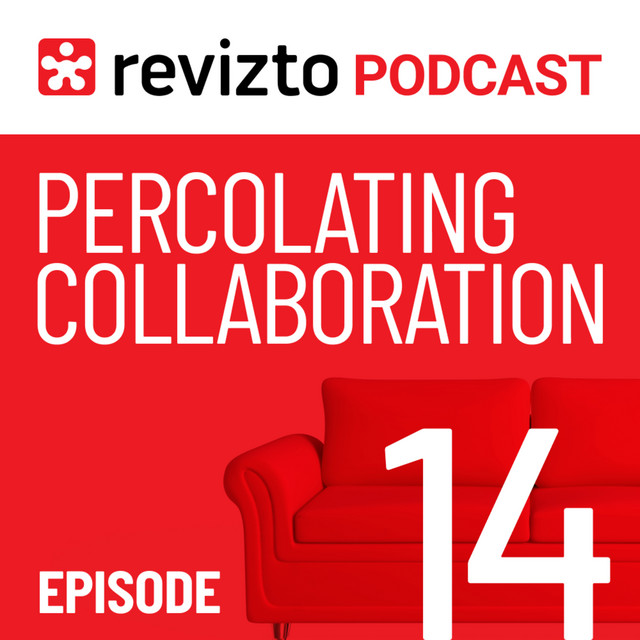

<header class="bg-podcast-hero">
  
Black Grid / In conversation

  <h1>Podcasts. Stories from the industry.</h1>
  
Honest conversations about construction, the people behind it, and making technology work on real projects. Join Luke Johnson behind the mic on Building Stories, or across the table as a guest.

  <nav class="bg-podcast-jump" aria-label="Podcast sections">
    <a class="bg-button bg-button-secondary" href="#podcasts-i-host">Podcasts I host ↓</a>
    <a class="bg-button bg-button-secondary" href="#guest-appearances">Guest appearances ↓</a>
  </nav>
</header>

<section class="bg-podcast-section" aria-labelledby="podcasts-i-host">
  

    
01 / Behind the mic

    <h2 id="podcasts-i-host">Podcasts I host</h2>
  

  <article class="bg-podcast-show">
    
    

      
Building · Design · Engineering · Construction

      <h3>Building Stories</h3>
      
Real experiences, hard lessons and a bit of humour from the people who build. Luke and his fellow hosts speak with industry leaders about project delivery, digital change, leadership and the work behind the headlines.

      
Co-hosted with Michael Clothier · Powered by Deep Space

      

        <a class="bg-button bg-button-primary" href="https://podcasts.apple.com/au/podcast/building-stories/id1751474310">Listen on Apple Podcasts ↗</a>
        <a class="bg-text-link" href="https://www.deepspacegroup.ai/podcast">Explore the show ↗</a>
      

    

  </article>
  

    <h3>A few places to start</h3>
    
People, practical BIM and the story behind Deep Space.

  

  

    <article class="bg-podcast-pick">
      
Episode 28 / Ryan Alexiou

      <h4>Why Construction Change Needs a Human Fix</h4>
      
Culture, accountability and making new ways of working stick.

      <a href="https://podcasts.apple.com/au/podcast/episode-28-ryan-alexiou-why-construction-change-needs/id1751474310?i=1000712181654">Listen to episode 28 ↗</a>
    </article>
    <article class="bg-podcast-pick">
      
Episode 26 / Jonathan Sinclair &amp; Benny Huang

      <h4>Why BIM Alone Isn’t Enough</h4>
      
Turning digital tools into better cost, programme and quality outcomes.

      <a href="https://open.spotify.com/episode/2DCVwzeMi8gZLqZwSEkBcy">Listen to episode 26 ↗</a>
    </article>
    <article class="bg-podcast-pick">
      
Episode 22 / The Deep Space founders

      <h4>Why We Took the Risk</h4>
      
The founding team on building a construction technology business.

      <a href="https://open.spotify.com/episode/4nhu2GSkLikMuzZU5o1HbC">Listen to episode 22 ↗</a>
    </article>
  

</section>

<section class="bg-podcast-section" aria-labelledby="guest-appearances">
  

    
02 / Across the table

    <h2 id="guest-appearances">Guest appearances</h2>
    
Luke joins other hosts to talk about connected construction, BIM, AI and the realities of technology adoption.

  

  

    <article class="bg-podcast-guest">
      

      

        
Digital Construction Podcast

        <h3>How Deep Space is Empowering Mid Sized Builders</h3>
        
With Andrea Ciaffi · April 2026 · 25 min

        
Why digital tools struggle to take hold, how leadership shapes adoption, and what better implementation looks like for mid-sized builders.

        

          <a class="bg-text-link" href="https://open.spotify.com/episode/372W2IHk5ek0lprgqBPUka">Listen on Spotify ↗</a>
          <a class="bg-text-link" href="https://www.youtube.com/watch?v=BGvKJfyDjro">Watch on YouTube ↗</a>
          <a href="https://www.digitalconstructionpodcast.com/article/how-deep-space-is-empowering-mid-sized-builders-with-startup-co-founder-luke-johnson">Episode notes &amp; transcript ↗</a>
        

      

    </article>
    <article class="bg-podcast-guest">
      

      

        
AEC Trailblazers / e-verse

        <h3>From Dynamo Scripts to Scalable Platforms</h3>
        
With Valentin Noves · July 2025

        
The path from custom Dynamo workflows to Deep Space, connecting project data, and building software around the problems construction teams actually face.

        

          <a class="bg-text-link" href="https://open.spotify.com/episode/0fkEgESMIX3OMTiqocWJ31">Listen on Spotify ↗</a>
          <a class="bg-text-link" href="https://www.youtube.com/watch?v=6FAQLYG3kxg">Watch on YouTube ↗</a>
          <a href="https://e-verse.com/learn/from-dynamo-scripts-to-scalable-platforms/">Episode notes ↗</a>
        

      

    </article>
    <article class="bg-podcast-guest">
      

      

        
Percolating Collaboration / Revizto

        <h3>Working While We Sleep: AI’s Role in Construction’s Future</h3>
        
With Jason Howden · April 2025 · 33 min

        
Luke and Jason on the journey from BIM to Revizto and beyond: AI-assisted risk detection, simpler software stacks, and the people who shape a career in construction technology.

        

          <a class="bg-text-link" href="https://open.spotify.com/episode/0DkwNprpIYxHwOqM0g2IFS">Listen on Spotify ↗</a>
          <a href="https://www.linkedin.com/posts/lukesjohnson_bim-golf-share-7320755943636377600-43Vx/">Luke’s episode introduction ↗</a>
        

      

    </article>
  

</section>

  
Keep exploring practical BIM guides, Deep Space demos and the Something Tech talk.

  <a class="bg-text-link" href="../videos/">Explore Videos ↗</a>

