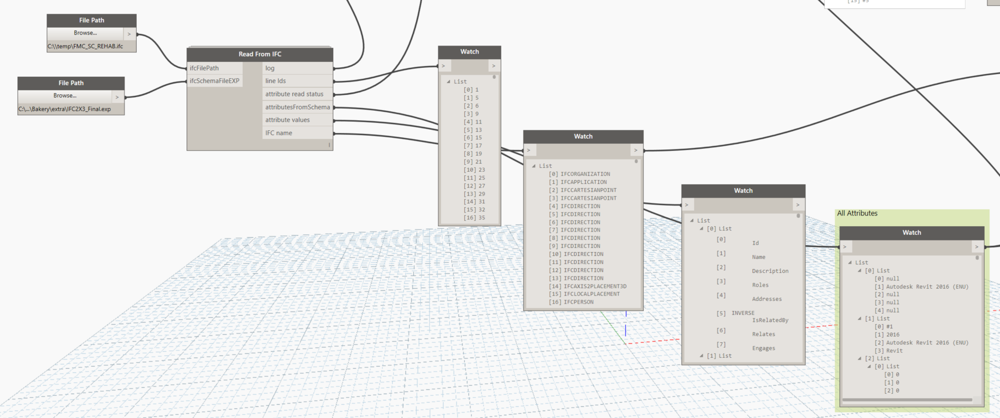
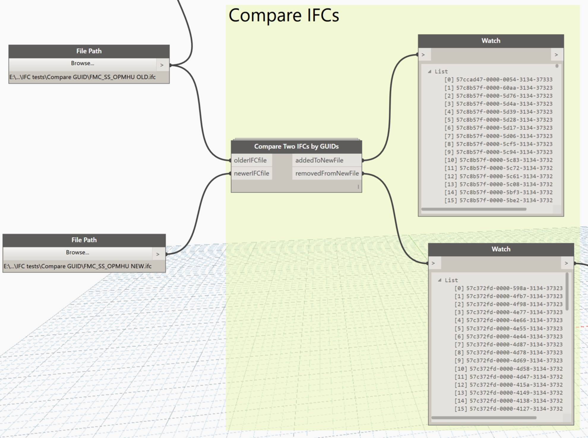
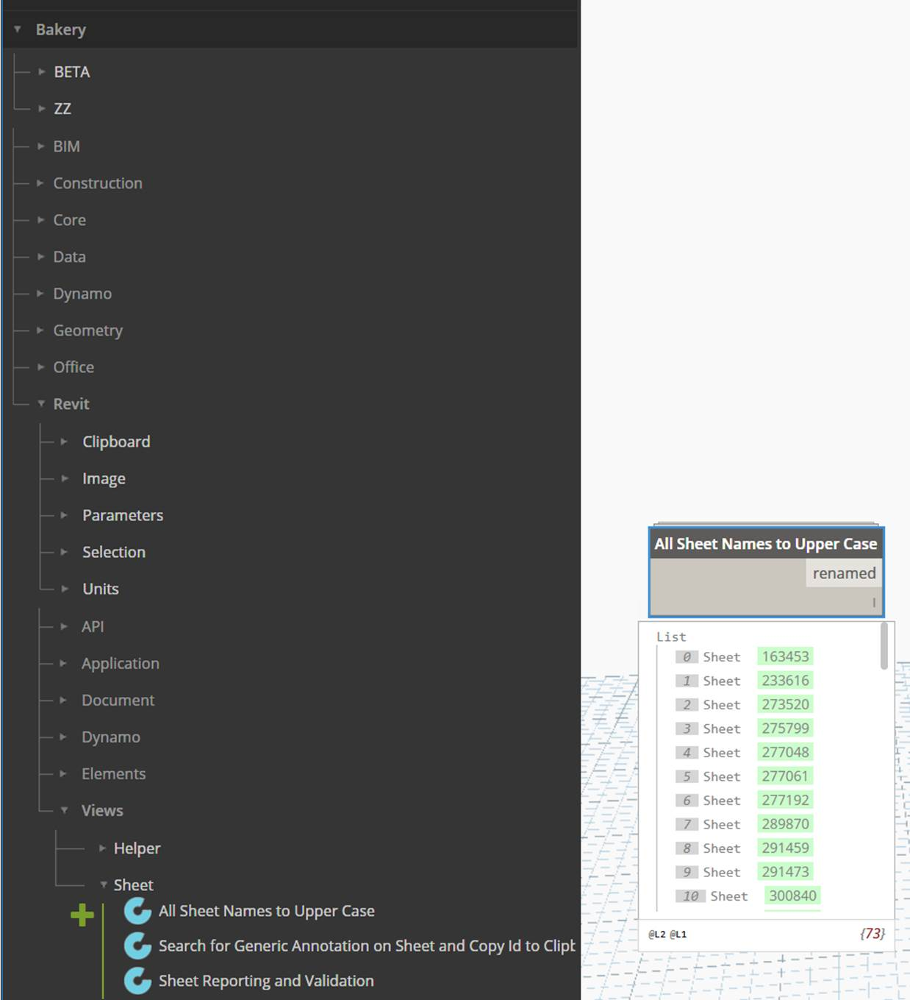

Black Grid / Dynamo &amp; Revit automation

# Bakery for Dynamo

Created by Luke Johnson

A practical toolkit for the work between modelling and delivery. Reusable Dynamo nodes and graphs for managing Revit models, working with BIM data and connecting information across files.

  <a class="bg-button bg-button-primary" href="https://github.com/LukeyJohnson/BakeryForDynamo">Browse the source ↗</a>
  <a class="bg-button bg-button-secondary" href="https://dynamonodes.com/2016/01/27/bakery-node-index/">Explore the node guide ↗</a>

  
<strong>750+</strong>Custom-node files in the Dynamo 2.0x archive, including helpers and derived nodes

  
<strong>Revit + IFC + data</strong>Model management, coordination and information workflows

  
<strong>Nodes + graphs</strong>Reusable building blocks, worked examples and supporting packages

<figure class="bg-screenshot">
  
  <figcaption>An original Bakery workflow: turning IFC text and a schema into data that can be inspected and filtered in Dynamo. <a href="https://dynamonodes.com/2016/09/07/read-from-ifc/">Read the original walkthrough</a> · <a href="../../assets/bakery/ifc-data.png" target="_blank" rel="noopener">Full-size screenshot ↗</a></figcaption>
</figure>

## Built from everyday BIM problems

Bakery grew out of Luke's hands-on work with Revit and BIM delivery: finding the right elements, checking model information, managing linked files and making the same change consistently across many views or sheets. The useful routines became reusable Dynamo nodes, then a shared package that others could inspect, combine and adapt.

The collection spans small conveniences and more involved automation. A node can tidy sheet names; a graph can gather information from linked models, reshape spreadsheet data or help investigate differences between IFC exports. The common idea is to make a repeatable task understandable enough to run again, rather than rebuild it for every project.

Bakery brings together Luke's custom work, including XML processing with Python's ElementTree, and adaptations of community tools. Packages such as **Clockwork**, **archi-lab** and **LunchBox** are part of that foundation. The original [project introduction](https://dynamonodes.com/2016/01/22/what-is-bakery/) explains this approach, and the repository preserves the graph and node source alongside supporting package versions.

## What Bakery helps you do

<dl class="bg-bakery-capabilities">
  
<dt>Find and check model information</dt><dd>Collect elements by category, workset or parameter; inspect shared-parameter GUIDs; find duplicate values and report model conditions that need attention.</dd>

  
<dt>Manage views and sheets</dt><dd>Work with view disciplines, filters, templates, revisions and sheet names. Turn a repeated documentation task into a graph with explicit inputs.</dd>

  
<dt>Understand linked models</dt><dd>Gather external-file references, linked-element information and workset details. The example graphs also include BIM 360 path harvesting and reloading tools.</dd>

  
<dt>Work across IFC and coordination data</dt><dd>Read IFC information, extract identifiers, convert between IFC and .NET GUID formats, and compare identifier sets between two files.</dd>

  
<dt>Connect files, tables and parameters</dt><dd>Read and reshape Excel, CSV, XML and text data; clean strings and lists; move information into forms that a Revit workflow can use.</dd>

  
<dt>Build geometry-driven routines</dt><dd>Use room boundaries, curves, points and element geometry in modelling and review tasks, including floor creation and section-box workflows.</dd>

</dl>

[Browse the documented node groups](https://dynamonodes.com/2016/01/27/bakery-node-index/), or explore the [Bakery articles on Dynamo Nodes](https://dynamonodes.com/category/bakery/) for individual examples.

## See the tools in use

These are original screenshots from Luke's Dynamo Nodes articles, showing the package and workflows as they were documented.

<section markdown>

### Compare IFC identifiers

Give **Compare Two IFCs by GUIDs** an older and a newer IFC file. Its outputs identify GUIDs added to, or removed from, the newer file: a focused way to investigate changes in the identifier sets.

<figure class="bg-screenshot">
  
  <figcaption><a href="https://dynamonodes.com/2016/09/12/compare-two-ifcs-by-guids/">Compare Two IFCs by GUIDs · original article</a> <a href="../../assets/bakery/ifc-comparison.jpg" target="_blank" rel="noopener">Full-size screenshot ↗</a></figcaption>
</figure>

</section>

<section markdown>

### Standardise sheet names

**All Sheet Names to Upper Case** handles a small but repetitive documentation job in one operation. The screenshot shows the node in Bakery's library and its returned list of renamed sheets.

<figure class="bg-screenshot">
  
  <figcaption><a href="https://dynamonodes.com/2017/04/13/all-sheet-names-to-upper-case/">All Sheet Names to Upper Case · original article</a> <a href="../../assets/bakery/sheet-names.jpg" target="_blank" rel="noopener">Full-size screenshot ↗</a></figcaption>
</figure>

</section>

The same practical approach appears in the [view-discipline tools](https://dynamonodes.com/2016/10/31/set-discipline-property-for-views/), which enumerate and set disciplines across views, and [view-filter tools](https://dynamonodes.com/2016/08/04/add-view-filters-to-view/), which apply filters to a view.

## What is in the repository?

The [BakeryForDynamo repository](https://github.com/LukeyJohnson/BakeryForDynamo) contains more than the package itself:

- **Versioned Bakery collections.** Separate `BakeryForDynamo1.3x` and `BakeryForDynamo2.0x` folders preserve the package layouts, custom-node definitions and additional resources.
- **Supporting package snapshots.** Companion folders preserve versions of packages that Bakery workflows may reference, making their dependencies visible alongside the nodes.
- **Example Dynamo graphs.** The `dyn` folder includes BIM 360 path-harvesting and path-reloading examples, alongside a contributed section-from-line graph credited to Nick Culley in its filename.
- **Additional resources.** The repository also includes node icons and a separate RollingPin node collection.

### Working with the archive today

Bakery's public repository preserves historical Dynamo **1.3x and 2.0x** collections. Start with the versioned folder and its dependencies when inspecting or adapting a workflow for your Revit/Dynamo environment. These snapshots are a reference for the original tooling, rather than a statement of compatibility with every current release.

[Dynamo 1.3x collection](https://github.com/LukeyJohnson/BakeryForDynamo/tree/master/BakeryForDynamo1.3x){ .md-button }
[Dynamo 2.0x collection](https://github.com/LukeyJohnson/BakeryForDynamo/tree/master/BakeryForDynamo2.0x){ .md-button }

## Explore Bakery

The source is the place to inspect the implementation. Dynamo Nodes provides the explanations, node index and worked examples that put the tools in context.

  <a class="bg-button bg-button-primary" href="https://github.com/LukeyJohnson/BakeryForDynamo">Bakery on GitHub ↗</a>
  <a class="bg-button bg-button-secondary" href="https://dynamonodes.com/category/bakery/">Bakery articles &amp; examples ↗</a>

For more of Luke's Dynamo resources and the community he administers, visit <a href="../../dynamo/">Dynamo at Black Grid</a>.

