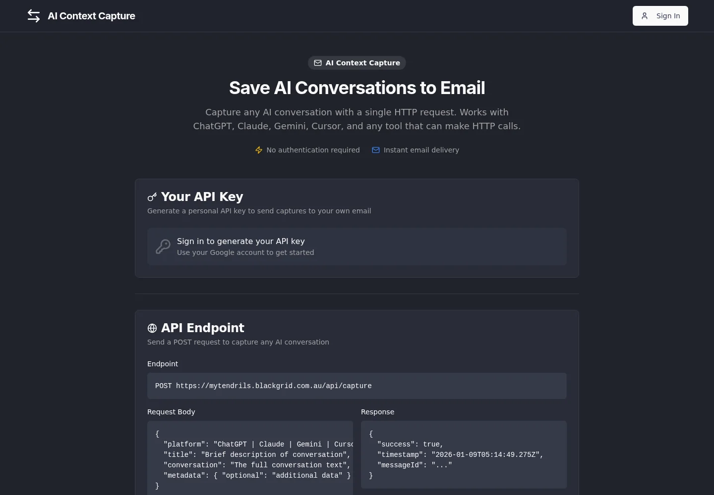

Black Grid / AI conversation capture

# mytendrils

AI Context Capture — save AI conversations.

[Open mytendrils :material-open-in-new:](https://mytendrils.blackgrid.com.au/){ .md-button .md-button--primary }

mytendrils preserves conversations from ChatGPT, Claude, Gemini, Cursor and similar tools so that solutions, code, research and decisions are not lost when a chat is closed.

## How it works

- **One HTTP POST** to the capture endpoint, with the conversation text and optional metadata — no account or sign-in required.
- **Delivered by email**, formatted and ready to file.
- **Call it from anywhere:** command-line tools, `curl`, Python scripts or mobile apps.

<figure class="bg-screenshot">
  
  <figcaption>The public mytendrils capture page — endpoint details and usage examples. Captured October 2026.</figcaption>
</figure>
