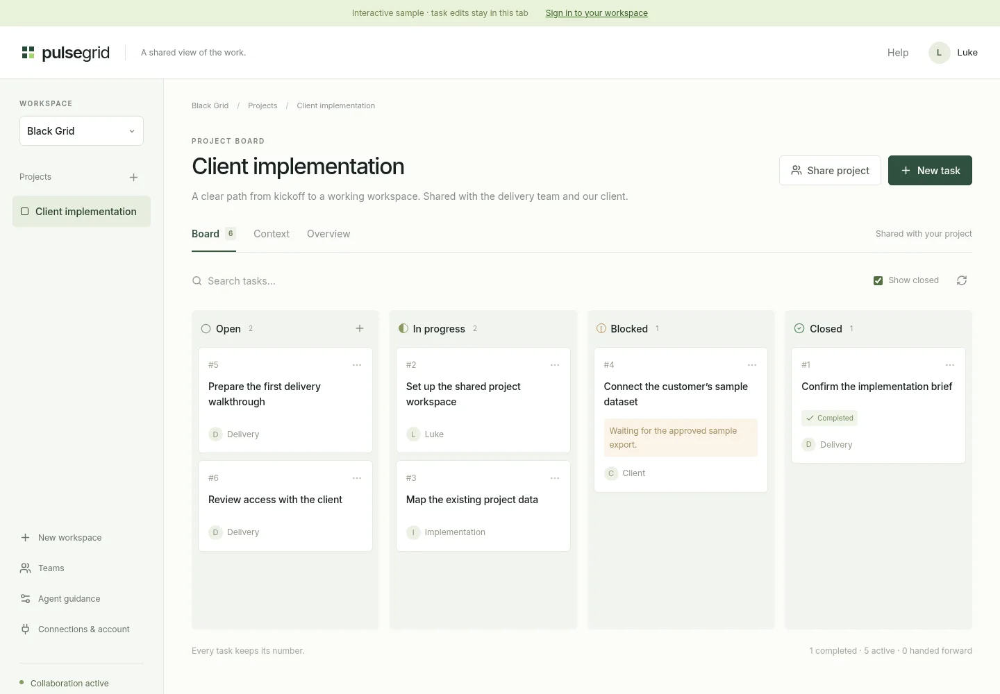

Black Grid / PulseGrid

# Your project. People and AI, together.

The MCP-powered extension to the original PMGrid. One shared board for your team, clients and the AI assistants you already use.

[Explore the sample board](https://pulsegrid-staging-7ps5dsadra-uc.a.run.app/preview){ .md-button .md-button--primary }
[Try early access](https://pulsegrid-staging-7ps5dsadra-uc.a.run.app/){ .md-button }

**PulseGrid builds on PMGrid’s projects, tasks, events and modular DataBlocks.** It adds a shared browser board, task discussion and personal AI connections through the **Model Context Protocol (MCP)**. Connect your own Codex or Claude client, choose its projects and permissions, and work with the same tasks and context your team sees.

!!! info "Early access"
    The current app is a staging environment for testing. Use a test project while production release is prepared. Live subscriptions are not open yet.

<strong>One shared board.</strong>People, clients and agents see the work.

<strong>Bring your own AI.</strong>Connect your personal Codex or Claude client.

<strong>Keep the context.</strong>Tasks, source material and discussion stay linked.

<figure class="bg-screenshot">

<figcaption>Illustrative sample project. Explore the board without signing in; sample edits stay in your browser tab.</figcaption>
</figure>

## From a brief to work everyone can follow

1. **Create a shared project.** Sign in with Google, activate collaboration and create a workspace and project. Grant each person viewer or collaborator access.
2. **Connect your own assistant.** Add PulseGrid to a compatible Codex or Claude client. Review the requested capabilities and select the projects or workspace it may use.
3. **Give the work some structure.** Ask your assistant to turn an email, brief or meeting transcript into tasks with completion criteria and linked source material. Review what it creates on the board.
4. **Work together.** Update tasks in the browser or through your agent. Attach DataBlocks, discuss the work and record evidence. When something remains unfinished, carry it into a linked follow-up task.

[Connect Codex or Claude](https://pulsegrid-staging-7ps5dsadra-uc.a.run.app/help/mcp){ .md-button }
[Read the user guide](https://pulsegrid-staging-7ps5dsadra-uc.a.run.app/help/user){ .md-button }

## What PulseGrid adds

| Capability | What it means for your project |
| --- | --- |
| Shared project board | Open, in-progress, blocked and closed work in a layout that adapts to desktop, tablet and phone. |
| Permanent task references | A task keeps its number when its title, order or status changes. Link back to the same work. |
| DataBlocks and source context | Attach reusable briefs, meeting transcripts and evidence. Pin a revision or deliberately follow live updates. |
| Discussion beside the task | Human comments and agent updates stay with the work. Browser drafts and retry protection help prevent lost or duplicate comments. |
| Personal MCP connections | Each person connects their own AI client and chooses its resources and capabilities. Connections can be revoked. |
| Clear agent handoffs | Agents can claim work, record blockers, verify completion and carry remaining scope into linked follow-ups. |
| Explicit project access | A collaborator seat enables changes within your grants. It never grants access to somebody else’s project. |

## Viewing and collaboration

-   __Free project viewing__

    ---

    Read the tasks, discussion and shared context in projects you are granted access to. Use your own Google account. A viewer invitation does not start a collaboration trial.

-   __One personal collaborator seat__

    ---

    **Launch offer: A$29 AUD per month.** One seat follows you across your permitted workspaces. A **one-calendar-month free trial** is available for activation from **1 November through 31 December 2026**, Brisbane time. An existing trial keeps its original end date.

During early access, try the collaboration workflow with test data. Live paid checkout will open separately from this staging release.

## Built on the original PMGrid

PMGrid introduced the connected workspace for projects, events, tasks and modular DataBlocks. **PulseGrid is its MCP-powered extension**, adding a shared board and a way for your own AI assistants to participate in that work.

The [original PMGrid](pmgrid.md) remains available. Existing PMGrid projects are not automatically moved into the early-access environment.

## A few practical questions

### Do I have to use an AI assistant?

No. You can create tasks, attach context and post comments in the browser. Connect an assistant when it helps with your work.

### Which AI clients can I connect?

Fresh OAuth connection setup has been tested with **Codex CLI** and **Claude Code**. See the [connection guide](https://pulsegrid-staging-7ps5dsadra-uc.a.run.app/help/mcp) for tested versions, setup and a first read/write workflow. Other hosts need their own compatibility check.

Your AI account is separate. PulseGrid does not include a hosted agent or AI credits, and posting a comment does not automatically start an agent.

### What can a client or viewer see?

Everyone with access can read the whole shared project, including its discussion and attached context. Keep private material outside that project. Viewing is free; changing the work requires a collaborator role and an active personal trial or seat.

### What happens when collaboration expires?

Permitted viewing and history remain available. Changes require renewed collaboration access. Project permissions and shared-context grants continue to apply independently.

[Explore PulseGrid](https://pulsegrid-staging-7ps5dsadra-uc.a.run.app/preview){ .md-button .md-button--primary }

